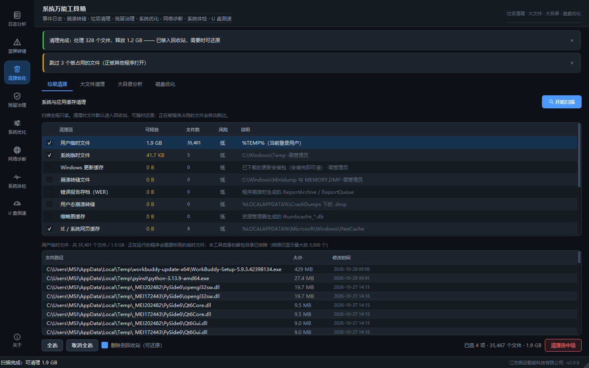
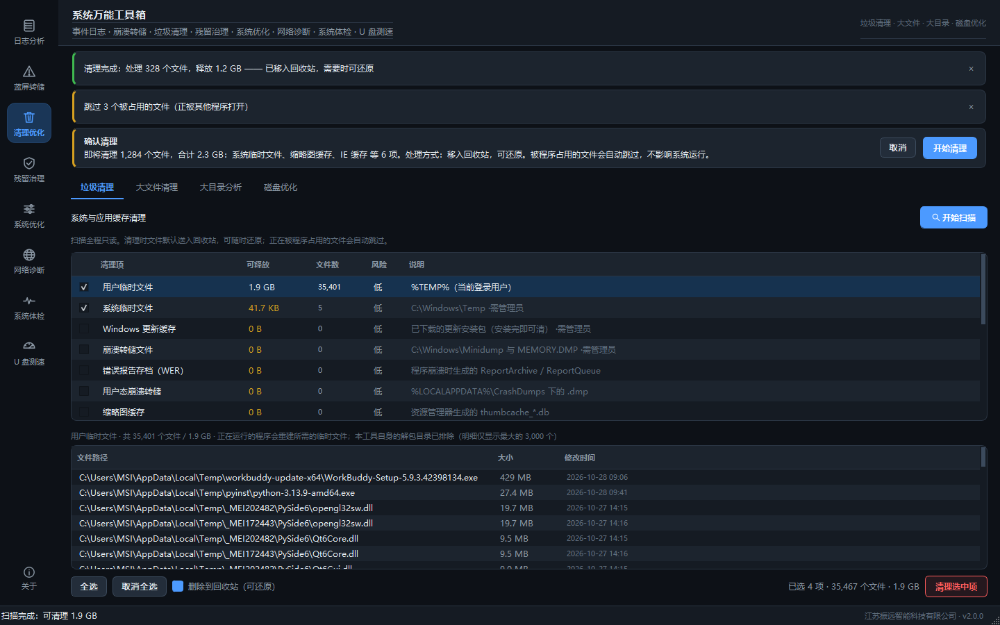
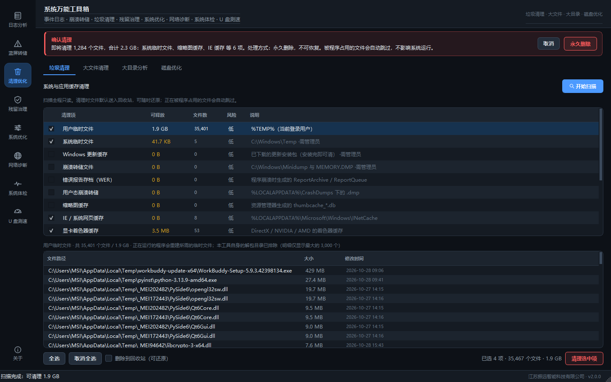
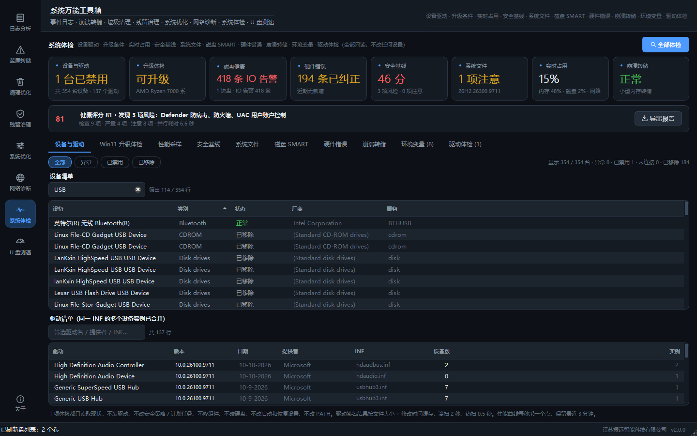
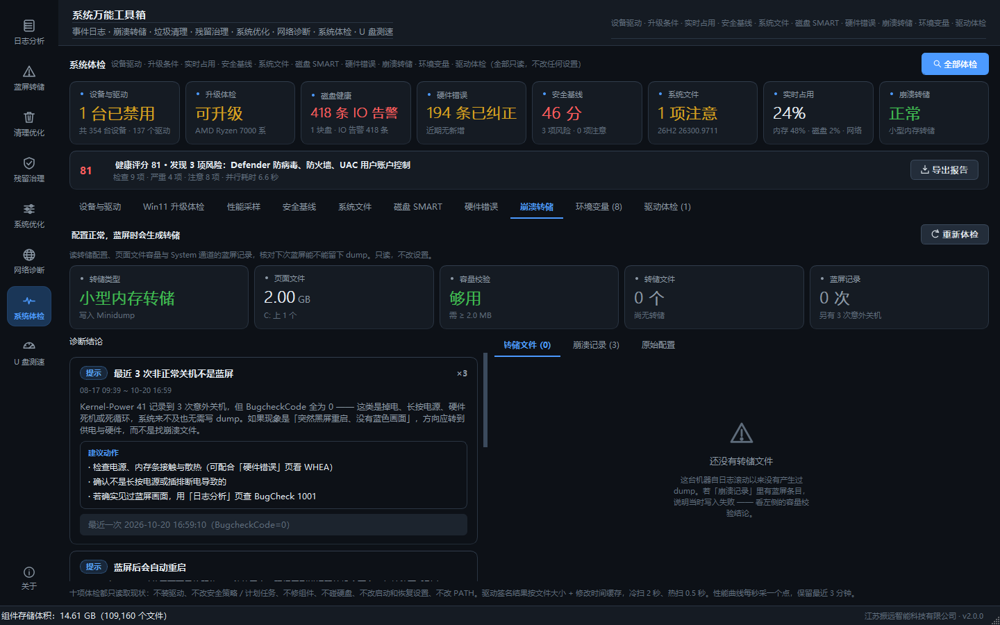

# 系统万能工具箱 · 使用手册

> SystemToolbox v2.1.1 · 江苏振远智能科技有限公司
> 一个 exe，九个工作台：**事件日志分析** + **蓝屏转储分析** + **清理优化** + **残留治理** + **系统优化** + **网络诊断** + **系统体检** + **U 盘测速** + **开机诊断**。

---

## 1. 这套工具解决什么问题

售后的真实场景通常是这样：客户说"机器老是蓝屏/自动重启"，你手上只有：

- 一个从现场拷回来的 `.evtx`（或能远程连上去读事件查看器）
- 一个 `C:\Windows\Minidump\xxxxx-xx.dmp`

传统做法是：事件查看器翻半天 + 找 BlueScreenView + 百度搜蓝屏码 + 猜。
本工具把这条链路收进一个窗口：

| 能力 | 说明 |
|---|---|
| 读日志 | 原生 `wevtapi` 读取实时通道与离线 `.evtx`，不依赖 PowerShell / 外部命令 |
| 出结论 | 把散落事件关联成诊断结论：蓝屏、掉电、磁盘、硬件、服务、应用 |
| 读转储 | 纯本地解析 MDMP 与内核转储，取出蓝屏码 / 异常码 / 参数 / 故障模块 |
| 给动作 | 每条结论都带"先查什么"，不是把数字翻译一遍 |
| 出报告 | 单文件 HTML（可直接发客户）+ Excel 明细（可二次统计） |
| 交叉验证 | 转储 ↔ 日志双向联动：蓝屏时间点直接跳到日志前后上下文 |
| 清垃圾 | 白名单式扫描 14 类缓存目录，默认送回收站，可还原 |
| 治残留 | 注册表孤立引用硬证据检测（自动备份）+ 卸载残留置信度识别 + **文件占用排查**（谁占着这个文件） |
| 空间治理 | 大文件检索、目录占用下钻、SSD TRIM / HDD 碎片整理 |
| 系统优化 | 系统与硬件概况、启动项启停（可复活）、服务白名单调优、18 项响应微调（按 Win10 / Win11 分流） |
| 变更记录 | 把三份备份折成一条时间线，看清「现在被改成了什么样」，一键全部还原 |
| 网络诊断 | 网卡 / ICMP / 外网 / 网关 / DNS / 端口 / 代理与 hosts 逐层排查，全只读 |
| 开机诊断 | 读 Windows 自己量的开机耗时，把「开机 62 秒」拆成进系统前 / 桌面出来后，再拆成八个阶段（引导、内核、驱动与设备、预取与自检、会话与服务、用户配置与桌面、登录后后台、未细分残差）；慢项点名到具体应用 / 驱动 / 服务 / 设备，关机与睡眠一并给 |
| 系统体检 | 设备与驱动（含问题码中文解释）、Win11 升级条件、CPU/内存/磁盘/网络实时曲线与**进程占用 TOP**、安全基线 10 项、**系统文件与组件健康**、**磁盘 SMART 寿命与累计写入**、**WHEA 硬件错误按部件聚合**、**崩溃转储配置体检**、**PATH 与环境变量体检**，全只读 |

---

## 2. 快速开始

### 2.1 三种入口

| 方式 | 操作 |
|---|---|
| 拖拽 | 把 `.evtx` 或 `.dmp` 直接拖到窗口任意位置，自动识别并切到对应工作台 |
| 通道 | 日志工作台 → 事件来源选通道（默认"系统 (System)"）→ 点「开始分析」 |
| 命令行 | `SystemToolbox.exe "D:\现场日志\System.evtx"` 直接打开并分析 |

### 2.2 权限说明（重要）

| 目标 | 需要的权限 |
|---|---|
| 系统 / 应用程序 通道 | 普通用户可读 |
| **安全 (Security)** 通道 | **必须管理员**（右键 exe → 以管理员身份运行） |
| `C:\Windows\Minidump\*.dmp` | 需要管理员（默认 ACL 限制） |
| `C:\Windows\MEMORY.DMP` | 需要管理员 |
| 别人拷回来的日志/转储文件 | 普通用户可读（注意文件可能被杀软锁定，先复制到本地） |
| 清理 `C://Windows//Temp` / 更新缓存 / Minidump | **必须管理员**，否则该行标「需管理员」且删不掉 |
| 磁盘优化（defrag / chkdsk） | **必须管理员**；「分析碎片」例外，只读不需要 |
| 修复系统级注册表项（HKLM） | **必须管理员**；HKCU 下的项普通用户可改 |

权限不足时工具会明确提示"访问被拒绝：读取该通道需要管理员权限"，不会静默返回空。

### 2.3 离线样本怎么取

```bat
:: 日志（事件查看器也可：右键通道 → 另存所有事件）
wevtutil epl System D:\现场\System.evtx
wevtutil epl Application D:\现场\Application.evtx

:: 转储
copy C:\Windows\MEMORY.DMP D:\现场\
xcopy C:\Windows\Minidump\*.dmp D:\现场\Minidump\ /Y
```

### 2.4 界面上这些提示怎么看

**这个工具运行时不会弹任何窗口。** 完成、失败、警告都在页面顶部出现一条横幅，
几秒后自己消失；危险操作的确认也在这条横幅里，点了才继续。

| 长什么样 | 什么意思 | 要不要管 |
|---|---|---|
| 左边一条绿色竖线 | 做完了（已清理 N 个文件、已复制 N 行…） | 不用管，会自己消失 |
| 左边一条黄色竖线 | 做完了但有保留（跳过了被占用的文件、部分项失败） | 看一眼，通常不用处理 |
| 左边一条红色竖线 | 没做成（导出失败、提权被拒、解析不了这个文件） | 看正文里的原因 |
| **淡红底、带「取消 / 确认」两个按钮** | **等你决定**。红色按钮表示不可撤销（删除、还原） | 必须点一个，它不会自己走 |

提示条**鼠标移上去会暂停倒计时**，方便你边看边记事。





切换工作台时上一条提示会自动收掉 —— 免得在「网络诊断」看到「清理完成」。

> **表格能直接复制**：任何表格上点右键，有「复制选中 N 行 / 复制全部 N 行 /
> 导出 CSV…」。复制的是制表符分隔的文本，粘进 Excel / WPS 会自动分列；
> CSV 带 UTF-8 BOM，用 Excel 直接打开中文不乱码。
> 表格支持 Ctrl / Shift 多选，不用一行一行抄。

> **表格能点表头排序**：任意一张表点一下列标题就按这列升序，再点一下降序，
> 表头上会出现一个小箭头。数字按数值排（`9` 在 `10` 前面），带单位的按实际大小排
> （`412 MB` 在 `12.3 GB` 前面），版本号按段比（`10.0.9` 在 `10.0.26100.9731` 前面），
> `—` 这类空值统一排在最后。排歪了点右键 →「恢复原顺序」。
>
> **表格能筛选**：设备清单、驱动清单、驱动包、磁盘 IO 告警、硬件错误这几张
> 行数多的表，上方有个输入框，输两个字就实时筛（任一列命中即可，不区分大小写），
> 右边会显示「筛出 5 / 354 行」。清空输入框即恢复全部。
>
> 勾选状态跟着行走：筛完再勾、勾完再排，选中的还是那几行，不会错位。



**窗口位置会被记住**（写在 `%LOCALAPPDATA%\SystemToolbox\ui.json`，不碰注册表）。
下次打开还是你上次的位置；如果那位置已经不在任何显示器上（比如拔了外接屏），
会自动回到默认位置。

> 皮肤只有深色一套（v2.0.0 起移除了浅色）。浅色原本给打印/投屏用，但现场
> 基本都是机房、值班室盯盘，实际没人切 —— 两套皮肤各要维护 30 个令牌的对比度，
> 不如把这份精力放回判断逻辑上。要浅色只能换工具，不再是这个程序的能力。

---

## 3. 日志工作台

### 3.1 顶部来源栏

- **事件来源**：内置 14 个常用通道（系统、应用、安全、Setup、Kernel-Power、StorPort 磁盘诊断、WHEA、驱动框架、计划任务、WLAN、RDP、Sysmon…）
- **打开 .evtx 文件**：选文件后来源锁定为文件，时间范围自动切到"全部时间"
- **时间范围**：最近 1 小时 / 6 小时 / 24 小时 / 7 天 / 30 天 / 全部
- **上限**：最多读取多少条（默认 80000）。日志极大时先降上限，用时间范围缩小窗口
- **HTML 报告 / Excel 明细**：分析完成后可导出
- **级别筛选 + 搜索 + 只看关键事件**：都是本地二次过滤，改条件**不需要重新读取**

### 3.2 六个 KPI 的含义

| 卡片 | 含义 |
|---|---|
| 事件总数 | 本次读取条数 + 覆盖的时间跨度 |
| 严重 / 错误 / 警告 | 按 Windows 事件级别统计（严重=Level 1，错误=2，警告=3） |
| 蓝屏 / 崩溃 | **BugCheck(1001) 事件次数**，不是"任何错误" |
| 健康评分 | 100 分制，按诊断结论严重度递减计分（≥85 良好 / 60-84 需关注 / <60 有问题） |

> 注意：健康评分低但"严重"是 0 并不矛盾——严重数统计的是事件级别，健康分统计的是**结论**（比如一万条"磁盘坏块"是错误级事件，但结论属于高风险）。

### 3.3 事件表

六列：时间 / 级别 / 来源 / ID / **含义** / 摘要。

- 「含义」列来自内置知识库，把 `7031` 这类数字直接翻译成"服务意外终止"
- 来源名已省略 `Microsoft-Windows-` 前缀，鼠标悬停看全名与事件数据
- 点表头可排序
- 单击某行 → 右侧「事件详情」显示结构化字段 + 「为什么值得注意」+「建议动作」，「原始 XML」是原生事件 XML

### 3.4 诊断结论（右侧第一页）

每条结论是一张卡片：**等级徽标 + 标题 + 时间范围 + 发生次数 + 解释 + 建议动作 + 证据行**。

- 点卡片右下角的活动提示，可把表格**定位到该结论对应的事件**，实现"结论 → 证据"一跳
- 结论文本里的数字都是真实统计（如"共 27 次，2026-06-22 08:59 ~ 08-27 19:49"）

---

## 4. 转储工作台

### 4.1 支持的文件

| 文件 | 说明 | 能读出什么 |
|---|---|---|
| `C:\Windows\Minidump\*.dmp` | 内核小内存转储（PAGEDU64） | 蓝屏码 + 4 个参数 + 处理器数 + OS 主次版本 |
| `C:\Windows\MEMORY.DMP` | 内核完整转储 | 同上（不解析物理页，秒开，GB 级文件也安全） |
| WER / 任务管理器创建的 `.dmp` | 用户模式迷你转储（MDMP） | 异常码、异常地址、**故障模块 + 模块内偏移**、全部模块与版本、线程数、PID、进程创建时间 |

### 4.2 读取本机蓝屏代码（不用先找文件）

工作台第一行有个主按钮 **「读取本机蓝屏代码」**。点它，工具自己去翻这台机器
蓝屏过的证据，你不用知道转储在哪、也不用先把文件拖进来。

它扫三处：

| 来源 | 位置 | 特点 |
|---|---|---|
| 转储文件头 | `Minidump\*.dmp`、`MEMORY.DMP`、`LiveKernelReports\**\*.dmp` | 最准。蓝屏瞬间由内核写入，读前 96 字节就够，GB 级文件也是毫秒 |
| `BugCheck` 1001 | System 事件日志 | 有蓝屏码，但只保留最近若干条 |
| `Kernel-Power` 41 | System 事件日志 | 掉电 / 硬关机，通常**没有**蓝屏码 |

结果列成一张表，五列：

| 列 | 怎么读 |
|---|---|
| 时间 | 精确到秒。有转储时取文件时间，只有事件时取事件时间 |
| 蓝屏码 | `0x000001CC` 这样；显示 `—` 表示这次没有码（掉电/硬关机） |
| 名称 | 微软的代码名 + 中文说明；鼠标悬停能看到参数、转储路径与完整解释 |
| 来源 | 小型转储 / 内核转储 / 实况内核报告 / 事件日志 |
| 说明 | 一句话：`驱动挂起 → 1 分 46 秒后硬关机`、`掉电/硬关机`、`转储已不在` |

**同一件事不会出现两行。** 转储在前、41 在后且间隔在 15 分钟内，视为同一次故障的
后续硬关机，合并成一行并写出间隔。

反过来，**多出来的 41 不会被吞掉**：一次蓝屏后面跟着两次非正常关机（间隔都在窗口内）时，
只有最近那条算「它的后续」，另一条单独占一行 —— 那是另一次关机，不是同一次。

三个容易踩的认知：

1. **「没有蓝屏码」不等于「没有记录」**。`Kernel-Power 41` 的 `BugcheckCode=0`
   说明是掉电、死机或强制关机 —— 这本身就是结论，方向是电源/散热/超频，不是驱动蓝屏。
2. **Minidump 目录是空的，也可能真蓝屏过**。驱动挂起时系统不写 Minidump，
   只在 `LiveKernelReports` 留一个 GB 级 dmp，而事件日志里那条 41 是 `code=0`。
   这时**只有转储头能拿到真正的蓝屏码**。
3. **同一个代码反复出现比偶发一次严重**。表里出现重复代码时，结论区会单列一张卡，
   意思是「那个方向的驱动或硬件问题一直没解决」。

选中一行后：

- **分析选中的转储**（或直接双击）—— 切到「模块清单 / 原始字段」按文件方式深挖
- **在文件夹中显示** —— 只有事件没有转储时这两个按钮是灰的，省得白点

> 全机扫描实测 87~155 ms。扫描结果会留在界面里，切页、切页签都不用重跑。

### 4.3 一眼看懂

- **蓝屏码卡片**：`0x00000124` + 中文名"硬件不可纠正错误（WHEA）"
- **故障模块卡片**：用户模式转储直接显示 `VI.UI.exe 5.2.1.0`；内核转储显示"需 cdb 解析"
- **诊断结论**：说明这个码指向哪个硬件/软件环节，并给出 3-5 条动作
- **模块清单**：基址、模块名、版本、大小、完整路径（排查"同名多份 DLL""版本老旧"很快）
- **原始字段**：直接从文件头解出来的原始值（异常记录、杂项信息、内核转储头），方便对照资料
- **调试器堆栈**：可选。装了 Windows SDK 的 Debugging Tools 后点按钮，自动跑 `cdb !analyze -v` 并下载微软符号

### 4.4 定位到代码位置

用户模式转储给出 `模块内偏移`，例如：

```
故障模块：VI.UI.exe 5.2.1.0，地址 0x7FF6A0173C58（模块内偏移 +0x173C58）
```

把这个偏移交给研发，配合对应版本的 PDB 即可在 WinDbg/VS 里直接落到函数。

### 4.5 与日志联动

如果先在日志工作台分析过、且窗口内有 BugCheck(1001) 事件，那么打开一个时间相近的转储时，结论区会多出一张"事件日志中同一时段有 N 次蓝屏记录"的卡片，点击直接跳到日志工作台并聚焦到蓝屏前后 10 分钟——这就是"证据链"。

---

## 5. 清理优化

左栏第三个按钮，四个子页签：**垃圾清理 / 大文件清理 / 大目录分析 / 磁盘优化**。

三条贯穿全页的安全前提：

1. **扫描只读**——扫描阶段不做任何移动或删除，只统计体积和数量；
2. **删除默认进回收站**——清理用的是 Shell 的回收站接口，误删可从回收站还原；
3. **占用的文件自动跳过**——正在被程序使用的文件删不掉，单独计数，不当失败刷屏。

> 清理系统缓存、整理磁盘、修复系统级注册表项需要**管理员权限**。
> 没提权时按钮会置灰，磁盘优化页右上角有「以管理员身份重启」按钮走 UAC 提权。

### 5.1 垃圾清理

点「开始扫描」后，表格按规则列出每一类的可释放体积与文件数：

| 列 | 含义 |
|---|---|
| 清理项 | 缓存分类名。后缀「需管理员」表示该目录当前权限下删不掉 |
| 可释放 | 该分类命中的总体积 |
| 文件数 | 命中文件个数（不是目录数） |
| 风险 | 低 = 清了系统会自己重建；中 = 清了有一定副作用（见右侧说明） |

选中某一行，下方会列出**将被删除的具体文件**（按体积降序，默认展示最大的 3000 个）。
默认只勾选「低风险且确实有内容」的分类，风险为中的一律不勾。

底部「删除到回收站（可还原）」默认开启。取消勾选会变成永久删除，
按钮旁会明确写出「不可恢复」。点「清理选中项」后还会弹一次确认，
列出每一类的体积与总数。

**为什么刚生成的文件不在列表里**：用户临时目录和系统临时目录都设了 **1 小时冷却**，
1 小时内改动过的文件不参与清理。这是为了避开正在写入的临时文件，
以及本工具自身 PyInstaller 解包目录（`_MEI*` 已硬编码排除）。

### 5.2 大文件清理

顶部**下拉选盘**（列表里带卷标与剩余空间，如 `C:　本地磁盘　·　剩余 133 GB / 391 GB`），
再选阈值（100 MB / 500 MB / 1 GB / 5 GB）→ 扫描。想只扫某个目录时，点「浏览」挑目录，
或直接在输入框里粘路径，两者可以混用。

结果按体积降序，勾选后可批量移入回收站，**双击任意一行直接在资源管理器里定位**。

扫描会跳过 `Windows`、`WinSxS`、`node_modules`、`.git`、`__pycache__`、虚拟环境
等目录，并对遍历量设上限（默认 60 万条目）。扫整个 C 盘能跑，
但想快的话建议只扫 `C:\Users\你的用户名`。

### 5.3 大目录分析

回答「C 盘空间到底被谁吃了」。**下拉选盘**（或浏览到具体目录）→「分析占用」，
表格给出每个**一级子目录**的：

- 真实占用（递归统计，不是目录项大小）
- 占当前层的百分比
- 文件数、最后修改时间

**双击某一行继续下钻**，点「上级目录」回退，输入框会跟着显示当前所在目录。
每次只统计当前层的子目录总量，不建整棵树，所以几百万文件的盘也不会把内存吃光。

### 5.4 磁盘优化

卷卡片显示盘符、卷标、容量条、已用/可用。介质类型判定用的是 Windows 自己的
`SeekPenalty` 属性（随机访问是否有代价），比按型号猜准；USB 设备显示「可移动存储」。

底部一行是物理磁盘健康（型号 / 总线 / 介质 / Healthy），来自 `Get-PhysicalDisk`，
读不到会显示「未获取」，不影响其他功能。

四个动作，全部调用系统自带命令，**工具本身不搬动任何数据**：

| 动作 | 命令 | 说明 |
|---|---|---|
| 按介质自动优化 | `defrag X: /O` | SSD 走 TRIM 回收，HDD 走碎片整理，由系统按介质决定 |
| TRIM 全盘回收 | `defrag X: /L` | 仅 SSD 可用，机械盘自动禁用 |
| 分析碎片 | `defrag X: /A` | **只读**，不改动数据，不需要管理员 |
| 扫描磁盘错误 | `chkdsk X: /scan` | 在线只读扫描，不锁卷，可随时中断 |

命令输出实时流式显示在下方「执行日志」，进度条只认真实的进度行
（不会被分析报告里的「总碎片空间 = 18%」带偏）。随时可点「停止」中断。

机械盘做完整碎片整理可能耗时很长，建议在下班前跑。

---

## 6. 系统优化

左栏第五个按钮（`Ctrl+5`），四个子页签。
这一页的原则和残留治理一致：**先说清楚，再动手；动了能退**。

### 6.0 按 Windows 10 / Windows 11 分流

页面顶部有一条常驻提示，写明这台机器按哪一代系统呈现：

```
● Windows 11 专业版 · 26H2 · 26300.9711  ·  Windows 11 分支：
  微调 14 项适配本机，另 4 项为 Win10 专属（表中灰显、不可勾选）
```

判定只看 **build 号**（≥ 22000 判为 Win11），不看注册表 `ProductName` ——
后者在 Win11 上至今仍写着 `Windows 10 Pro`，靠它会全线判错。
版本与代号（22H2 / 24H2…）的对应关系由内置表给出，`DisplayVersion` 存在时以它为准。

分流体现在三处：

- **微调项**：每项标了「适用」列（全部 / Win10 / Win11）。为另一代系统准备的项
  **灰显且没有勾选框**，点上去会说明原因，不会出现「点了没反应」的开关
- **服务判定**：某一代系统独有的服务（例如 Win11 的安卓子系统 `WSAIFabricSvc`）
  在另一代上会被判成「降级残留 · 不建议操作」，而不是「建议调优」
- **系统信息**：系统表里多一行「适配分支」，值为 `Win11 26H2（build 26300）`

### 6.1 系统信息（只读）

四个 KPI：内存占用、系统盘剩余、开机时长、进程数。下面两张表：

- **系统**：操作系统版本、计算机名、安装日期、架构、注册用户、当前权限、电源计划、防火墙、Defender
- **硬件**：内存、CPU（型号 + 物理核 / 线程）、整机、主板、BIOS、显卡、各分区占用

再往下是**内存占用 TOP 12**，按工作集排序，并给出当前进程总数。

版本号有一处要说明：Win11 的注册表 `ProductName` 至今仍写着 `Windows 10 Pro`，
直接显示会误判系统。这里按 build 号（≥22000 判为 Win11）纠正，
再用 `EditionID` 映射成中文版别，所以显示的是 `Windows 11 专业版 · 26H2 · 26300.9711`。
这套判定集中在 `app/core/winver.py`，系统表里的「适配分支」一行就是它的结论（见 6.0）。

显卡一栏会额外把远程控制软件装的**虚拟显示器**（向日葵、GameViewer 之类）
单独标成「虚拟显示」，避免把它们当成真显卡。

### 6.2 启动项

三类来源合并成一张表：

| 来源 | 位置 |
|---|---|
| 注册表 | `HKCU` / `HKLM` 的 `CurrentVersion\Run`，含 WOW64 的 32 位视图 |
| 启动文件夹 | 当前用户与所有用户的 `Startup` 目录 |
| 计划任务 | 触发条件为「登录时 / 启动时」的任务（直接解析 `System32\Tasks` 下的 XML） |

**禁用不等于删除**，三条路径都能原样恢复：

- 注册表项 → 写 `Explorer\StartupApproved\Run*`（任务管理器用的同一套机制，
  系统仍认得这个启动项，只是不执行）
- 启动文件夹项 → 移到 `%LOCALAPPDATA%\SystemToolbox\backup\startup_disabled\`
- 计划任务 → `schtasks /change /disable`

表格会标出两类可疑项：**「指向的程序已不存在」**（程序已被卸载，启动项还在）
和**「位于临时目录」**（多半是直接运行压缩包里的 exe 留下的）。
「发布者」一列读的是 exe 版本资源里的公司名，看得出一项是谁装的。

上方四个筛选：第三方 / 全部 / 已禁用 / 程序缺失。默认「全部」，
第三方任务排在微软自带任务之前。每次开关动作都会追加到
`backup\startup_actions.jsonl`，出问题可以照原始记录还原。

### 6.3 服务

扫出全部 Win32 服务后分四档：

| 判定 | 含义 | 是否给操作按钮 |
|---|---|---|
| 可调优 | 有明确收益（SysMain、Windows Search、遥测、Xbox 等） | 给 |
| 第三方 | 第三方软件安装的服务 | 给 |
| 常规 | 系统自带但没有调优收益 | 给（不建议动） |
| 核心服务 | RPC / DCOM / 事件日志 / 电源 / 安全中心等 | **不给** |

默认只看「建议调优」那一档，每项都写了具体收益，例如：

- **SysMain**：机械盘上能加速冷启动；SSD 上收益很小，禁用可省内存与后台磁盘占用
- **Print Spooler**：没有打印机可以禁用；有打印机务必保留
- **BITS**：系统更新与部分下载依赖它，不建议禁用

禁用只改启动类型（并尝试停止），**首次改动前把原始启动类型记进 `services.json`**，
点「恢复原状」按原值写回。整个过程走 `advapi32`，不调 `sc.exe`。

**需要管理员权限**：没有提权时页面顶部显示「普通权限 · 部分项需要管理员」，
旁边有「以管理员身份重启」。

### 6.4 响应微调

18 项开关，双击任意一行即可切换。按适用系统分三组，表里「适用」列就是这张表的
后两组标记；不属于本机的项会灰显且不能勾选。

**通用（Win10 / Win11 都生效）**

| 项目 | 改动 | 风险 |
|---|---|---|
| 菜单展开延迟 | `MenuShowDelay` 400 → 0 | 低 |
| 鼠标悬停响应 | `MouseHoverTime` 400 → 100 | 低 |
| 窗口缩放动画 | `MinAnimate` 1 → 0 | 低 |
| 登录后启动项不延迟 | `StartupDelayInMSec` = 0 | 低 |
| 关闭透明效果 | `EnableTransparency` 1 → 0（核显/远程桌面更跟手） | 低 |
| 开始菜单搜索不查网络 | `BingSearchEnabled` = 0 | 低 |
| 崩溃时不弹错误报告 | `DontShowUI` = 1 | 低 |
| 更快结束无响应程序 | `HKCU\Control Panel\Desktop\HungAppTimeout` → 2000 | 低 |
| 关机等待服务超时 | `WaitToKillServiceTimeout` 5000 → 3000 | 中（需管理员） |
| 启用长路径支持 | `LongPathsEnabled` = 1 | 中（需管理员，Win10 1607+，重启生效） |
| 切到高性能电源计划 | `powercfg /setactive` | 中（笔记本更耗电） |

**Win11 专属**

| 项目 | 改动 | 说明 |
|---|---|---|
| 隐藏任务栏「小组件」 | `TaskbarDa` 1 → 0 | 资讯小组件入口，隐藏后不再常驻拉内容 |
| 隐藏任务栏「聊天」 | `TaskbarMn` 1 → 0 | 内置 Teams 入口，隐藏后不再随系统启动 |
| 收起开始菜单「推荐」 | `Start_IrisRecommendations` 1 → 0 | 22H2 起才有；24H2 后该区域改叫「最近使用」 |

**Win10 专属**

| 项目 | 改动 | 说明 |
|---|---|---|
| 隐藏任务栏 Cortana 按钮 | `ShowCortanaButton` 1 → 0 | Win11 已把它并进搜索 |
| 关闭任务视图「时间线」 | `EnableActivityFeed` 1 → 0 | Win11 已移除时间线 |
| 停止上传活动历史 | `PublishUserActivities` 1 → 0 | 跨设备活动同步是 Win10 的功能 |
| 关闭任务栏缩略图预览 | `TaskbarNoThumbnail` = 1 | Win11 任务栏由系统设置接管，写了不生效 |

改之前会把**「原值 + 本来是否存在」**写进 `backup\tweaks.json`。
还原时优先照备份写回；**原来没有这个值的，还原就是把它删掉**——
所以「优化 → 还原」之后注册表和动手前完全一致，不会留下 `0` 或空值这类垃圾。
没有备份记录时（比如你本来就手动设成了这个值），「还原」是**删值回到系统默认**，
不会硬写一个猜的默认值 —— 同一项在不同 build 上默认值可能不同。
需要重启的项在「说明」列里写明了。

---

### 6.5 变更记录与一键还原

第五个页签。本工具对系统的改动全都可逆，但原始记录散在三处备份里：

| 备份文件 | 记什么 |
|---|---|
| `startup_actions.jsonl` | 启动项每次开关的原始数据（追加式，含历史动作） |
| `services.json` | 服务**首次**改动的原始启动类型（同名不覆盖） |
| `tweaks.json` | 微调**首次**改动前的原值（含「本来是否存在」标志） |

单看任何一份都答不出「这台机器现在被我改成了什么样」。这一页把三份折成
**一条按时间倒序的时间线**：

| 列 | 含义 |
|---|---|
| 时间 | 记录写入时间 |
| 模块 | 启动项 / 服务 / 微调 |
| 动作 | 已禁用 / 已启用 / 已优化 / 已改启动类型 / 已还原 |
| 对象 | 显示名（启动项用条目名或计划任务名） |
| 详情 | 原始值 → 当前值；启动项还会写出所在注册表路径 |
| 状态 | 生效中 / 已还原 |

右上角胶囊可筛「全部 / 生效中 / 已还原」。

**三个刻意的设计**

1. **同一项来回切换只保留最后一次动作** —— 中间反复点的不值得占十行；
2. **「是否仍生效」是读注册表现值判出来的**，不是照抄备份文件。
   你手动把值改回去了，它也会显示「已还原」；
3. **已还原的记录仍留在表里**（保留操作痕迹），但不计入待还原数量。

**一键全部还原**

右上角「一键全部还原」，一次退三类改动：

| 类型 | 怎么还原 |
|---|---|
| 启动项 | 重新启用（只处理本工具记录过、且当前处于禁用状态的项） |
| 服务 | 写回备份里的原始启动类型 |
| 微调 | 按 `tweaks.json` 的原值写回；原值本来不存在的就**删值** |

已经在原状态的目标直接跳过，不重复写注册表。服务与微调需要管理员权限，
非管理员运行时会如实报「需要管理员」，不会假装成功。

---

## 7. 残留治理

左栏第四个按钮，三个子页签：**注册表冗余 / 卸载残留 / 文件占用**。

前两页处理的是「软件卸载了但没卸干净」。两者判定方式完全不同：

- 注册表冗余 → **硬证据**（登记路径确实不存在），可以放心删；
- 卸载残留 → **启发式推断**（目录对不上已安装清单），只能当参考。

第三页「文件占用」不删任何东西，只回答一个问题：**这个文件被谁占着**。

### 7.1 注册表冗余

只检测五类，每一类都必须有「路径在磁盘上不存在」这个客观证据：

| 类别 | 判定 |
|---|---|
| 卸载项残留 | Uninstall 子键登记的反安装程序与安装目录**全部**不存在 |
| 启动项失效 | `Run` / `RunOnce` 指向的文件不存在（`rundll32`、`svchost` 等系统宿主跳过） |
| 右键菜单失效 | `ContextMenuHandlers` 引用的 COM DLL 不存在 |
| COM 组件失效 | `CLSID\InprocServer32` 指向第三方目录的 DLL 不存在（可选深扫，默认关闭） |
| 应用路径失效 | `App Paths` 登记的 exe 不存在 |

**不扫描也不删除**：`SYSTEM` 分支、`Services`、`Winsock`、安全策略、字体、驱动。
Microsoft / Windows 自身组件也在 COM 深扫里被排除（更新程序会重新注册它们）。

结果默认勾选「低风险」项。点「备份并修复选中项」后：

1. 先把待删的键整个 `reg export` 合并成一个 `.reg`，存到
   `%LOCALAPPDATA%\SystemToolbox\backup\registry_年月日_时分秒.reg`；
2. **备份失败就中止**，一个键都不删；
3. 备份成功后逐个删除，需要管理员的项会失败并单独列出。

删错了怎么办：双击那个 `.reg` 文件，确认导入，重启相关程序即可还原。

### 7.2 卸载残留

思路是「先建已安装软件索引，再去文件系统找对不上的目录」：

1. 从 Uninstall 键收集所有已安装软件的 DisplayName、Publisher、InstallLocation，
   以及每个反安装程序所在目录；
2. 扫描 `Program Files`、`Program Files (x86)`（各下钻一层）、
   `ProgramData`、`LOCALAPPDATA`、`APPDATA`（各一层）；
3. 与索引比对，对不上的候选目录进入置信度打分。

打分依据（界面上每条都会写明具体命中了哪几条）：

- 目录内**没有任何 exe/dll** → 大幅加分（程序主体已不存在）
- 已 180 天 / 365 天没有改动 → 加分
- 目录名含 `uninstall` / `backup` / `old` / `temp` → 加分
- 目录名是 GUID 形式 → 加分（安装缓存）
- 目录内仍有多个可执行文件 → **大幅减分**（可能是在用的绿色软件）
- 30 天内有改动 → 减分
- 注册表 `Software` 下仍有同名键 → 减分（可能还在用）

置信度 < 60 直接不展示；≥ 82 标「高」，≥ 68 标「中」。
系统目录、`WindowsApps`、`ProgramData` 下的中文目录、各种包管理器缓存
（`Package Cache`、`node_modules` 等）都在扫描前就被排除。

**默认一项都不勾选**——这一页的结论只是「值得你去看看」，
决定权必须是人。勾选后删除同样走回收站。

### 7.3 文件占用

现场最常见的两个问题：「这个文件删不掉」「这个软件装不上」。原因八成是
**有进程还开着它**，但 Windows 的报错只会说「文件正在使用中」，不说是谁。

这一页直接给出答案。

#### 怎么用

把文件（或整个文件夹）拖进来，或点「选择文件…」「选择文件夹…」，
然后回车 / 点「查占用」。也支持直接粘贴完整路径。

- 选**文件**：查这一个。
- 选**文件夹**：只查**直接子文件**（不递归子目录，最多 500 个）。
  因为「这个文件夹删不掉」真正要回答的是「下面哪个文件被占着」，
  递归下去几千个文件反而没有结论。
- 「只看占用的」默认勾选 —— 干净的文件不占版面。

#### 结果怎么读

上表是文件清单，三列：**状态 / 占用数 / 文件名**。

| 状态 | 含义 | 该怎么办 |
|---|---|---|
| 被占用 | 有进程持有它 | 看下表，关掉对应程序再试 |
| 未占用 | 没有进程持有 | 问题不在「被锁」，而是权限（需要管理员）或路径本身有问题 |
| 系统独占 | 页面文件、休眠文件、注册表 hive 这类内核持有 | 查不到进程是正常的，要释放只能改系统设置或重启 |
| 查不了 | Restart Manager 拒绝登记（目录、超长路径等） | 看说明列的具体原因 |
| 路径不存在 | 已经被删了，或路径拼错 | 正常现象，不是故障 |
| 未查完 | 文件太多、被占的太多，12 秒预算用完了没逐个确认 | 指定具体文件再查，或换个更小的文件夹 |
| 组内占用 | 没逐个确认，但**这一组文件里确实有占用** | 说明列会写出占用者名字，缩小范围即可 |

下表是**选中文件**的占用进程：PID、程序名、程序类型、状态、是否可重启、
可执行文件的完整路径。「可重启」= 关掉它之后程序能自己回来（例如资源管理器）。

#### 文件太多时它会自己收手

查一个文件夹时，如果里面**大部分文件都被同一个服务占着**（典型是
`C:\Windows\System32\winevt\Logs`，446 个 `.evtx` 里三分之一被事件日志服务持有），
逐个确认要 110 秒以上 —— 这个等待没有意义。

所以查询有 **12 秒预算**：分 32 个一块推进，预算用完就停手。
已经确认的块给出逐个结论，剩下的标「未查完」；如果停手时上级批次已经查到
占用者，就标「组内占用」并把名字写出来（例如「占用者：Windows Event Log」）。
中途也可以点「停止」，同样会保留已经查到的部分。

#### 数据从哪来

`Restart Manager`（`rstrtmgr.dll`）—— 就是安装程序弹出
「请关闭以下程序后继续」时用的那个接口。它比枚举句柄快得多：
单文件 **8~70 ms**，几百个文件一批也是百毫秒级。

#### 为什么它看不到页面文件

Restart Manager 报告的是「为了替换/删除这个文件，需要重启哪些程序」，
所以它只跟踪**用户态**的占用关系。`pagefile.sys`、`hiberfil.sys`、
注册表 hive 由内核直接持有，它返回的是「0 个进程」——
这时候写「没有进程占用」就是错的，所以工具按文件名单独识别成「系统独占」。

#### 边界

只查询，不关进程、不卸载、不强行删除。查到「是 chrome.exe 占着」之后，
关不关、什么时候关，由你决定。

---

## 8. 网络诊断

左栏第六个按钮（`Ctrl+6`）。先回答**「连不上」到底卡在哪一层**，
再回答**「连上了到底有多快」**（第四个页签 `宽带测速`）。

诊断部分全只读：不改网卡、不重置 Winsock、不动 hosts、不关防火墙。

### 8.1 结论表的顺序就是排查顺序

| # | 检查项 | 不通意味着什么 |
|---|---|---|
| 1 | 网卡 | 一块带地址的网卡都没有 → 先看设备管理器，别在网络设置里打转 |
| 2 | ICMP 自检 | 连 `127.0.0.1` 都不通 → 本机 ICMP 被策略禁用，后面所有 ping 类结论都不可信 |
| 3 | 外网连通 | 阿里 / 腾讯 / Google DNS 三个都不可达 → 出网被断（路由、防火墙、上游） |
| 4 | 网关连通 | 网关不回 ICMP **未必**是故障：多数路由器默认禁 ping。外网通就不算问题 |
| 5 | DNS 解析 | 域名解析不出来，但 IP 能通 → DNS 配错或上游 DNS 挂了 |
| 6 | DNS 服务器 / 本机端口 | 列出正在用的 DNS，以及 445、3389 在本机是否监听 |
| 7 | 系统代理 / hosts | 代理开着但代理本身不通、hosts 被改过 —— 都会造成「网络正常却打不开网页」 |

**为什么先测外网再测网关**：先按「外网通不通」定性，再看网关。
如果反过来，一台很好的机器会因为路由器禁 ping 而报一堆红。

### 8.2 四个 KPI

| 卡片 | 含义 |
|---|---|
| 诊断结果 | 正常 / N 项异常，副标题是检查项数与总耗时 |
| 主网卡 | 默认路由所在网卡的速率，副标题是 IP 与网卡名 |
| 外网延迟 | 最快那个探测目标的往返毫秒 |
| DNS 解析 | 解析 `www.baidu.com` 的耗时 |

### 8.3 网卡与地址

| 列 | 说明 |
|---|---|
| 网卡 | 注册表里的 Description；虚拟网卡没有 Description 时取连接友好名 |
| IPv4 地址 | `IP/掩码`；没地址的网卡不列出 |
| 网关 | 为空表示这块网卡没有默认路由 |
| DNS | 从 `DhcpNameServer` / `NameServer` 取，多值时逗号分隔 |
| 速率 | `GetIfTable` 的链路速率，链路没起来时可能为 `—` |
| 链路 / 方式 | 已连接 / 已断开 · DHCP / 静态；虚拟网卡额外标「虚拟」并灰显 |

排序是 **物理主用 → 其它物理 → 虚拟 → 环回**。
WSL / Hyper-V / VPN / TAP / Tailscale 这类会被标成虚拟网卡，
不会被当成「网卡故障」误报 —— 这是现场最常见的误判来源。

### 8.4 监听端口

只列 **TCP 监听**端口，按端口号升序。四列：端口、监听地址、进程、PID。

- **双击一行**可以打开该进程所在目录（`QueryFullProcessImageNameW`）
- 进程名走 `tasklist` 一次性换整表映射 —— 非管理员下 `OpenProcess`
  打不开 Services 会话里的系统进程（`svchost` / `System`），会一片空白

### 8.5 hosts 与代理

- 顶部一行文字给出**系统代理**状态（含「配置里保留但未启用」这种半开状态）、
  PAC 地址、hosts 自定义记录条数
- 表格里 `0.0.0.0` / `127.` / `::1` 开头的记录**灰显**：这是广告屏蔽的正常写法，
  迅雷、去广告工具都会往 hosts 里塞上百条
- 只有「**常见域名**（microsoft.com / windowsupdate.com / baidu.com / qq.com …）
  指向**具体公网 IP**」才会标黄，那是劫持或屏蔽更新的典型特征
- 「打开 hosts 所在目录」按钮直接定位到 `%SystemRoot%\System32\drivers\etc`

### 8.6 为什么不用 ping / nslookup / netstat

| 原因 | 说明 |
|---|---|
| 可能被拦 | 受管控机器上安全策略会拦外部命令（本项目实测过 `schtasks.exe` 被拦） |
| 输出是本地化文本 | 中文系统的 `ping` 输出是中文，按英文关键字解析必错 |
| 拿不到细节 | `netstat -ano` 给 PID，但拿不到进程名；`nslookup` 不问响应耗时 |

所以全部走 `ctypes` + `socket`：注册表取地址、`GetIfTable` 取链路、
`IcmpSendEcho` 发 ICMP、`GetExtendedTcpTable` 取监听表。

### 8.7 宽带测速（第四个页签）

诊断回答「能不能连」，测速回答「连上了有多快」。

先选**节点**和**时长**，点右上角「开始测速」，5 秒档大约 13 秒出结果。

| 控件 | 怎么选 |
|---|---|
| 节点 | 默认「自动」：先给腾讯云 / 华为云 / 阿里云各拉 0.8 秒，挑出最快的前两名，再让它们各开 4 条连接同时压 |
| 时长 | 5 秒（默认）/ 8 秒 / 12 秒 —— 越长越稳，流量也越大 |

四个 KPI：

| 卡片 | 含义 | 怎么算 |
|---|---|---|
| 下载 | 稳态下载速度 | 4 线 × 最多 2 个节点，剔除前 1 秒慢启动后按「字节数 ÷ 时间」 |
| 上传 | 稳态上传速度 | 3 线并发向 Cloudflare 发 4 MB 定长数据块 |
| 网络延迟 | TCP 握手往返 | 对节点连续 8 次建连，丢掉第一次（含 DNS/路由预热）后取平均 |
| 抖动 | 相邻两次延迟的平均差 | 越小越稳；语音、游戏看这个而不是看延迟 |

结果表给的是：测速节点、并发连接数、**下载峰值**（窗口内最高 1 秒）、
**达成率**（实测 ÷ 网卡协商速率）。曲线是实时速度，蓝色下载、绿色上传。

#### 结论怎么读

第一句永远是「这是几兆的宽带」，不用自己拿数字算：

| 实测下载 | 结论 |
|---|---|
| ≥ 700 Mbps | 千兆档 —— 千兆口实测天花板约 940 Mbps，跑不到 1000 是正常损耗 |
| 400~700 | 约 500M 档的上限 |
| 150~400 | 约 200~300M 档 |
| 70~150 | 约 100M 档 |
| 25~70 | 约 50M 档 |
| < 25 | 连 50M 档都没跑到 |

第二句才看网卡，而且分情况说，避免误报：

- **网卡协商速率 ≥ 2.5 Gbps**：直接说明「跑不满是宽带套餐决定的，不是网卡瓶颈」。
  本机就是 2.5G 网口 + 千兆宽带，达成率只有三成多 —— 拿它当故障就是误报
- 达成率 ≥ 85%：带宽基本跑满
- 达成率 40%~85%：通常就是套餐上限
- 达成率 < 40% 且是无线：Wi-Fi 实际吞吐只有协商值的三到六成，插网线再测才有可比性
- 达成率 < 40% 且是有线：查网线类别、是不是插在百兆口、后台有没有下载在抢带宽

其余提示按需出现：上传不足下载的 1/10（家宽非对等，属正常）、延迟 > 80 ms、
抖动 > 30 ms、上传节点不可达、HTTPS 证书被中间设备拦下。

#### 为什么是「2 个节点 × 4 条连接」

单节点跑不准，这是实测出来的：

| 口径 | 结果 |
|---|---|
| 同一时刻三个节点 | 腾讯 308 / 华为 162 / 阿里云 5 Mbps |
| 同一节点连测两轮 | 腾讯 809 与 836、华为 618 与 757（逐秒能看到 364 这种坑） |
| 2 个节点 × 4 线 | 874 与 891，逐秒波动从 ±300 收到 ±80 |
| 同一节点 8 线 | 589，比 4 线还慢，还多出一堆 `416` |

所以并发是**横向铺到第二个节点**，不是纵向堆在一个节点上。
只有 1 个节点可用时会退回单节点 4 线，结果表里会标「只有 1 个可用」，
这时数字会偏低一些。

#### 流量与安全

- 5 秒档在千兆线上跑一次约 **600 MB** 流量（下载 + 上传合计），面板上有实际数字
- 下载只拉三个 Ubuntu 镜像站的公开文件（`ubuntu/ls-lR.gz`，约 38 MB，读完再从头循环）
- 上传只往 `speed.cloudflare.com/__up` 发**定长填充字节**，不含任何本机信息
- 随时可以「停止」，停止后仍给出已跑完的部分，并注明「数字只反映已跑完部分」
- 测速期间点「开始诊断」会被拒绝 —— 带宽被打满时测出的延迟和 DNS 全都不准

> 结果不落盘保存；留在界面里直到下次重跑（切页签不会丢）。

---

## 9. 系统体检

左栏第七个按钮（`Ctrl+7`）。十个页签回答十类问题：**硬件到底长什么样**（设备与驱动）、
**这台机器能不能升 Win11**、**现在卡在哪**（性能采样 + 进程 TOP）、
**有没有明显的安全缺口**（安全基线）、**系统文件还完好吗**（系统文件）、
**硬盘还能用多久**（磁盘 SMART）、**硬件有没有在报错**（硬件错误）、
**蓝屏了能不能留下证据**（崩溃转储）、**命令找不到是不是 PATH 的问题**（环境变量）、
**驱动是谁装的、签名靠不靠得住**（驱动体检）。

全只读：不装驱动、不更新驱动、不禁用设备、不改任何安全策略、不修组件存储、
不对硬盘下任何 SMART 指令、不改启动和恢复设置、不改 PATH、不落盘采样数据。

顶部八个 KPI：

| 卡片 | 含义 |
|---|---|
| 设备与驱动 | 设备总数，副标题是异常 / 已禁用 / 已移除的分布 |
| 升级体检 | 能否升级，副标题是阻塞项与注意项数量 |
| 磁盘健康 | 需要处理的盘数或 IO 告警数，副标题是盘数与 IO 告警条数 |
| 硬件错误 | 致命 / 已纠正条数，副标题是最近 7 天是否仍在发生 |
| 安全基线 | 百分制评分，副标题是风险 / 关注项数量 |
| 系统文件 | 组件健康结论，副标题是累积更新号 |
| 实时占用 | CPU 百分比，副标题是内存 / 磁盘 / 网络 |
| 崩溃转储 | 配置是否会让下次蓝屏留下 dump，副标题是当前转储类型 |

首次切到本页会自动跑一遍九块静态检查（约 3~6 秒，在后台线程里跑，界面不卡），
之后的性能采样是持续的、1 秒一个点。本页的九项静态检查只在首次进入
（或手动点「一键体检」）时跑；跑到一半切页再回来，会重新扫一遍（约 5 秒）。

### 9.0 一键体检与体检报告

顶部 **全部体检** 按钮把九块静态检查并发点着（性能采样是持续流，不进结论）。
九项**全部回来之后**，KPI 下面会多出一条结论：

```
81  健康评分 81 · 发现 3 项风险：Defender 防病毒、防火墙、UAC 用户账户控制
    检查 9 项 · 严重 4 项 · 注意 8 项 · 并行耗时 5.8 秒          [ 导出报告 ]
```

| 部分 | 含义 |
|---|---|
| 左侧数字 | 健康评分 0~100：≥85 绿、60~84 黄、<60 红 |
| 第二行 | 一句话结论，取**最严重**的那个板块（不是按页签顺序取第一个） |
| 第三行 | 检查项数 · 严重几项 · 注意几项 · 并行耗时 |
| 右侧按钮 | 导出报告（HTML / Excel） |

几点必须知道的判定口径：

- **评分按板块平均**：严重扣 40、注意扣 15，一个板块再糟也只扣自己那一份。
  若按问题条数线性扣，8 个「注意」就能把一台整体正常的机器算成 36 分，没有参考价值。
- **结论只在九项全部跑完时出现**。中途不做半成品 —— 半份结论比没有结论更误导。
- **没跑到的项写「本次未运行」**，不会悄悄当成正常。
- 结论**复用页签已经扫到的数据**，不会为了出报告再扫一遍。

点 **导出报告**，选 `网页报告 (*.html)` 或 `Excel 工作簿 (*.xlsx)`：

| 格式 | 内容 | 适合 |
|---|---|---|
| HTML | 单文件、自带样式、离线可看、可直接打印。健康评分圆环 + 九格等级 + **优先处理**（所有建议动作去重汇总）+ 逐板块结论卡 | 发给客户 / 售后 / 研发，对方不用装任何东西 |
| Excel | 三个工作表：`体检结论`、`问题清单`（含建议动作）、`指标` | 自己归档、多机对比 |

报告里每条结论都带**建议动作**，可以直接发出去，不用再口头解释一遍。
某一块跑挂了，报告里会写「本项未完成：<原因>」，不会假装没问题。

### 9.1 设备与驱动

上下两块表：上面是**设备清单**（按实例，一台机器可能 350+ 条），
下面是**驱动清单**（按 `描述 + 版本 + INF` 合并，同一 INF 的多个设备实例算一条）。

筛选条四档：`全部` / `异常` / `已禁用` / `已移除`，右侧实时显示分布，例如：

```
显示 357 / 357 台 · 异常 0 · 已禁用 1 · 未连接 0 · 已移除 182
```

**状态是怎么判出来的**（这一段是实测踩出来的，别改成"没启动就是故障"）：

| 状态 | 判据 |
|---|---|
| 正常 | 配置管理器**没有**报问题码 |
| 已被禁用 | `DN_DISABLED` 或 `CM_PROB_DISABLED(22)` |
| 未连接 | `CM_PROB_DEVICE_NOT_THERE(24)` / `CM_PROB_DEVICE_RESET(45)` —— 设备没插 |
| 已移除 | `CM_Locate_DevNodeW` 返回 `CR_NO_SUCH_DEVNODE(13)`：注册表里有条目、系统里没这台设备（重装系统后的残留） |
| 异常 | 其它 `CM_PROB_*`，按严重度分 crit / warn / info |

为什么不用「是否启动」当判据：`Motherboard resources`、`System timer`、`PCI Express Root Complex`
这类**资源节点本来就不报启动标志**，本机实测 191 台会被误标成「未启动」。
所以判定逻辑只有一条：**配置管理器报问题码才算异常**。

问题码中文名与处置建议来自 `PROBLEM_CN`（51 项，覆盖 `CM_PROB_*` 全量常见值），
鼠标停在该行「服务」列可以看到完整提示。

两个采集细节：

- **跳过 SWD 枚举**：`SWD\` 下面本机有 102 条纯软件节点（设备体验、WPD 之类），
  对售后排查没有意义，直接不枚举
- **设备名与类别名**：`DeviceDesc` 常是 INF 字符串引用形态 `@usb.inf,%token%;回退文本`，
  `SHLoadIndirectString` 只认 `@dll,-123` 这种，所以解析顺序是
  「分号后的回退文本 → INF 的 `[Strings]` 段 → `SHLoadIndirectString(MUI)`」；
  类别名读 `Control\Class\{GUID}` 的 `ClassDesc`（Win11 上这个键的**默认值不存在**，只能读 ClassDesc 或退到 `Class`）

驱动清单列：驱动 / 版本 / 日期 / 提供者 / INF / 设备数 / 实例。
**「日期早于 3 年」只统计第三方驱动** —— 微软收件箱驱动日期普遍是 2006 年，
把 `usbhub.sys` 算成「三年没更新」是没有意义的噪音。

### 9.2 Win11 升级体检

按微软公布的硬件要求逐项对照，8 项一表：

| 项目 | 官方要求 | 说明 |
|---|---|---|
| 处理器 | 1 GHz 及以上、2 核以上、64 位 | 本工具额外判代际 |
| 内存 | 4 GB 及以上 | 差多少直接写出来 |
| 系统盘容量 | 64 GB 及以上 | 显示 `C: 共 X GB（可用 Y GB）` |
| 系统固件 | UEFI | 传统 BIOS 会明确给出「先转 GPT 再改启动模式」 |
| TPM | TPM 2.0 且已启用 | 区分「没模块」和「有模块没启用」 |
| 安全启动 | 支持且可开启 | 关闭只算注意项，不影响升级可行性 |
| 显卡 | 支持 DirectX 12 / WDDM 2.0 | **只给参考，不替你下结论** |
| 当前系统 | Windows 11 | 已经是 11 就标"无需升级" |

判定三档：`符合` / `注意` / `不满足`。结论行给出 `可以升级` 或 `N 项阻塞`，
阻塞项就是表里标红的那些。

**CPU 代际怎么判**（微软的官方兼容列表是一长串型号，这里用规则近似）：

- Intel：`12th Gen` 这类直接读代数；`i7-8550U` 这种按型号数字取首位
  （5 位型号如 `i7-10610U` 取前两位且限定 10~19）→ ≥8 代判符合，判不出算注意
- AMD：按 `Ryzen` 系列桶展示（`Ryzen 7 7735HS` 属 7000 系，不是 7735 系），
  Ryzen 2000 及以下判不满足，2000（Zen+）判注意
- 判不出来的不猜：给「读不到型号，请用 CPU-Z 核对」

显卡取的是设备树里的显示适配器，会过滤 `virtual` / `远程` / `GameViewer` / `idd`
这类虚拟显示器（串流软件装的假显卡），有真卡时优先真卡。

### 9.3 性能采样

四条曲线，两张图：

- 上图：CPU（蓝）/ 内存（黄）/ 磁盘占用（红），0~100%
- 下图：网络下行（绿）/ 上行（蓝），单位 KB/s，纵轴自动缩放

右上角两个按钮：`暂停采样` / `清空曲线`。上方四组实时数字是当前值，比曲线更精确。

采样与指标口径：

| 指标 | 来源 | 口径 |
|---|---|---|
| CPU | `GetSystemTimes` | `busy = (内核 + 用户) - 空闲`。**内核时间包含空闲时间**，不减掉会虚高到 100% |
| 内存 | `GlobalMemoryStatusEx` | `dwMemoryLoad`（与任务管理器口径一致） |
| 磁盘 | PDH `\PhysicalDisk(_Total)\% Disk Time` | 用 `PdhAddEnglishCounterW` 加英文路径，中文系统上也成立 |
| 网络 | `GetIfTable` 的 `dwInOctets/dwOutOctets` | 跳过 `IF_TYPE_SOFTWARE_LOOPBACK` 与未连通的接口，全接口求和后做差分 |

- 采样间隔 1 秒，曲线保留最近 180 个点（3 分钟窗口），满了从头部丢弃
- **第一个点一定是 0**（差分还没有历史值），采样器内部已经把它丢掉，不会在开局画一个假谷底
- 采样只活在内存里，不写日志、不落盘。切走页面即停表，不会后台空转

#### 进程占用 TOP（曲线下半区）

曲线回答「整机忙不忙」，这张表回答**「是谁在忙」** —— 售后现场客户说「卡」，
第一句要问的就是这个。表里列 7 项：

| 列 | 含义 | 排查用法 |
|---|---|---|
| 进程 / PID | 可执行文件名；鼠标悬停看完整路径 | — |
| CPU | 占用百分比 | **口径与任务管理器完全一致** |
| 内存 | 工作集（任务管理器「内存」列同源） | 看整体占用 |
| 私有 | 私有工作集 `PrivateUsage` | **查内存泄漏看这个**，共享的 DLL 不算进来 |
| 句柄 | 内核对象句柄数 | 持续上涨 = 句柄泄漏 |
| 线程 | 线程数 | 几百上千线程的进程要留意 |
| 启动 | 进程创建时间 | 判断「是不是刚重启过」 |

- 排序三档胶囊：`CPU` / `内存` / `句柄`，**双击一行直接打开该进程所在目录**
- 表里只显示前 40 名，标题右侧会写「TOP 40 / 192 个进程 · 16 核 · 全机口径」，
  还有本次枚举耗时（约 24 毫秒）
- 有进程打不开（权限不足）时会单独提示「N 个进程权限不足」，不会假装它们不存在

**CPU 百分比是这个口径，别按单核理解**：

```
24 核机器上，一个吃满单核的进程显示 100/24 ≈ 4.2%
整机所有进程加起来满载才是 100%
```

工具刻意做成与任务管理器一致（而不是「满一核 = 100%」的 Process Explorer 口径）。
第一版按满一核算，一个吃满单核的进程会显示 `100.19%`，看着像把整机占满了 ——
售后对着任务管理器一对就发现对不上。所以百分数是两位小数，数字小是正常的。

进程表**每 2 秒刷新一次**（曲线仍是 1 秒一个点）：每秒重建几十行会让选中行和滚动位置
一直跳，看着很躁。点「暂停采样」时表和曲线一起停。

### 9.4 安全基线

10 项只读检查，按严重度排序（风险在前）：

| 检查项 | 风险判定 |
|---|---|
| Defender 防病毒 / 实时保护 | 防病毒与实时保护都关才判风险；装了第三方杀软并正常接管判「符合」 |
| 防火墙 | 域 / 专用 / 公用三档全关判风险，部分关判注意 |
| UAC 用户账户控制 | 关闭判风险，「开启但提权不提示」判注意 |
| SMBv1 协议 | 服务或驱动任一启用即判风险（勒索软件横向移动的主力通道） |
| 远程桌面 | 已允许远程连接判注意（3389 会被互联网上的爆破脚本持续扫描） |
| 自动登录 | 注册表 `DefaultPassword` 存明文判风险，仅开启自动登录判注意 |
| 匿名 SMB 会话 | `RestrictNullSessAccess=0` 判注意，未显式设置只做提示 |
| 安全启动 | 未开启只做提示（`info`），不算风险 |
| TPM | 未启用只做提示 |
| 系统支持期 | Win10 19045 已停止支持判注意，更老版本判风险 |

四个视觉档：`风险`（红）/ `注意`（黄）/ `符合`（绿）/ `提示`（灰）。

顶部的百分制评分 = 100 - 风险×20 - 注意×8。
**它不是安全评级，只是一个横向对比的粗略刻度** —— 分数低大概率是真有问题，
但分数不高不代表机器安全，毕竟不检查补丁级别、不检查账号口令强度、不扫漏洞。

第三方接管 Defender 的那个判断值得单独说：装了火绒 / 卡巴斯基的机器上，
`Get-MpComputerStatus` 会如实报告「Defender 已关闭」，只看这一句就会把一台正常机器判成高风险。
所以额外查 `root/SecurityCenter2` 的 `AntiVirusProduct` 列表，
`productState & 0x1000` 为真表示这个杀软**正在实时防护**，有接管方就判「符合」。

### 9.5 系统文件与组件健康

蓝屏、更新失败、「某个功能装不上」查到最后一层，往往落在**组件存储坏没坏**上。
这一页八项，全部只读：

| 检查项 | 数据源 | 怎么判 |
|---|---|---|
| 组件存储 | `DISM /Online /Cleanup-Image /CheckHealth` | 三种结论：未检测到损坏 / **存在可修复损坏** / 已损坏且无法修复 |
| SFC 扫描记录 | `CBS.log` 里的 `[SR]` 标记 | 有记录说明跑过 `sfc /scannow`；「未运行过」只是提示，不是错 |
| 组件服务错误 | `CBS.log` 尾部 8 MB | 按日志级别 + HRESULT 判，噪音单独计数、不报警 |
| 挂起操作 | `RebootPending` / `PackagesPending` / `RebootRequired` / `pending.xml` / 待改名文件 | 有就提示「先重启一次再看」，此时更新类操作容易失败 |
| 组件日志 | `%SystemRoot%\Logs\CBS\CBS.log` | 超过 200 MB 说明刚做过大更新，可清理 |
| 累积更新 | `CurrentBuildNumber` + `UBR` | 显示成 `26H2 26300.9711`，**核对补丁级别看这个，别看版本名** |
| 最近补丁 | `CBS\Packages` 里 `Package_*_for_KB` | 按安装时间倒序，给最近 5 个 KB 号 + 日期 |
| 组件存储体积 | `WinSxS` 递归 | 默认「未统计」，点「统计体积」才跑 |

判定四档：`异常`（红）/ `注意`（黄）/ `正常`（绿）/ `提示`（灰）。

#### CBS.log 里的「失败」绝大多数不是错

这是这一页最容易做错的地方。`CBS.log` 里刷得最多的一句是：

```
Failed to internally open package. [HRESULT = 0x800f0805 - CBS_E_INVALID_PACKAGE]
```

它每次枚举包都会写，属完全正常的噪音（本机 6800 多行里有 8 条）。
按关键字抓 `Failed` / `Error` 就会让这一页一打开就是红的，用户直接不信这个工具。

所以判定是**两条一起看**：日志的级别字段（`Error` / `Warning` 才算）+
HRESULT 的白名单（`0x800f0805`、`0x80070002` 归噪音，`0x800f081f`、`0x800f0831`
这类才是真损坏）。`Info` 级、又没有已知坏码的行整条忽略 ——
连 `Package ... does not have an install time` 这种正常记录也不会再被误抓。

#### 三个必须知道的实现取舍

1. **`SessionsPending` 不能当证据**：这个键在正常机器上**常驻**（本机 8 个子键）。
   拿它判「有待重启」会永久误报，所以只采信 `RebootPending` / `RebootRequired` /
   `pending.xml` / `PendingFileRenameOperations` 这四条。
2. **WinSxS 体积默认不算**：11 万个文件、15 GB 左右，递归要十几秒到一分钟。
   做成按需按钮后可以中断（切走页面、关窗都会停），结果会缓存。
   中断时会标「未扫完」，数字只增不减，再点一次可补全。
3. **DISM 需要管理员**：非管理员会失败，此时这一项降级为灰色「提示」并写明
   「以管理员身份重跑」，不判红 —— 权限不足不等于机器有问题。

#### 看到「存在可修复损坏」该怎么办

这是本机实测真实命中过的一条。它的意思是：组件存储里有损坏，但**可以被修**，
典型表现是某些更新反复装不上、某个可选功能开了就报错。

手动修的命令（本工具不会替你执行，需要联网 + 管理员）：

```bat
DISM /Online /Cleanup-Image /RestoreHealth
sfc /scannow
```

先跑 DISM 再跑 SFC，顺序别反 —— DISM 修的是「源」，SFC 修的是「文件」，
源坏了 SFC 也修不动。

### 9.6 磁盘 SMART

「这块盘还能用多久」在这里回答。数据来自
`Microsoft-Windows-Storage-Storport/Health` 事件里的 **NVMe 健康日志原页**，
不是靠第三方工具，也不用管理员权限。

上半区每块盘一行，九列：

| 列 | 含义 | 怎么读 |
|---|---|---|
| 磁盘 / 总线 / 容量 | 型号、NVMe / SATA / USB、容量 | 型号与容量来自系统盘清单，按型号匹配 |
| 剩余寿命 | `100 − Percentage Used` | ≥80% 正常；60~80% 留意；<20% 该换；≤5% 会转只读 |
| 温度 | 复合温度 | ≥70℃ 偏热，≥80℃ 主控会降速甚至掉盘 |
| 累计写入 | 从出厂到现在的总写入量 | 配合「剩余年限」看消耗速度 |
| 通电 | 通电小时数 | 与购买时间对照，能看出是否二手翻新 |
| 状态 | 判定结论 | 级别颜色：绿 / 蓝 / 橙 / 红 |
| 处置建议 | 该做什么 | 正常时显示「各项指标均在健康区间」 |

判定顺序是**先致命、再寿命、再温度**：

1. `Critical Warning` 任一位置位 → 红（介质只读、备用空间耗尽、可靠性降级）
2. 介质与完整性错误 > 0 → 红（已经读到坏块且 ECC 修不回来）
3. 可用备用 ≤ 阈值 → 红（备件块快用完，写放大失控）
4. 已用寿命 ≥95% → 红；≥80% → 橙；≥60% → 蓝
5. 温度 ≥80℃ → 红；≥70℃ → 橙
6. 异常掉电次数 ≥20 且占通电次数一半以上 → 橙

一个必须注意的口径：**健康日志是「开机约 11 分钟时」写的一条快照**，不是此刻的温度。
寿命、累计写入这类慢变量完全不受影响，温度会略有滞后，
所以页面上写的是「记录于 …（开机后快照）」，不写「当前温度」。

「剩余年限」是用最早与最新两条快照差分出来的日均写入量反推的，
样本不足一天就显示「样本不足」，不会硬编一个数字。

下半区是**磁盘 IO 异常**，来自系统日志，与上半区的 SMART 指标互相对照：

| 事件 | 现象 | 级别 |
|---|---|---|
| ID 7（`disk`） | 磁盘有坏块 | 红 |
| ID 51（`disk`） | 分页操作时磁盘错误 | 红 |
| ID 129（`storahci` / `stornvme` / `UASPStor` …） | 控制器复位 | 橙 |
| ID 153（`disk`） | IO 操作重试 | 橙 |
| ID 157（`disk`） | 磁盘意外移除 | 橙 |

这里有个容易踩的坑：**事件 ID 必须连 Provider 一起看**。
系统日志里的 ID 7 有相当一部分来自 `Microsoft-Windows-Hyper-V-VmSwitch`，
内容是「虚拟网卡初始化成功」，跟磁盘毫无关系；只有 `disk` 这个 provider 的
ID 7 才是坏块。本工具按 `(Provider, 事件ID)` 联合判定，
不会把虚拟网卡的消息算成坏盘。

同一秒内的同类事件会合并成一行并显示次数 —— 一次控制器复位常连带刷四五条重试，
逐条铺出来只会把表格刷成一片同样的文字。

### 9.7 硬件错误

「这台机器有没有硬件在报错」在这里回答。数据来自两个 WHEA 通道，
但**不是「有事件就算故障」**。

| 级别 | 含义 | 处理 |
|---|---|---|
| 致命 | 直接导致蓝屏停机 | 必须定位部件 |
| 已纠正 | 硬件自己纠正过来了 | 单次不致命，**密度高说明在劣化** |
| 可恢复 | 记录为可恢复 | 关注但不紧急 |
| 通知 | 信息性记录 | 不表示故障 |

每一行都聚合到「级别 + 部件」，部件靠 CPER 分节的 GUID 判定：
处理器（通用 / IA32-x64）、内存、PCIe 设备/链路、固件。

**为什么不能按通道统计**：`Kernel-WHEA/Operational` 里绝大多数是「错误源通知」
（每次开机刷几百条，只是通报有哪些错误源），本机 2000 条里 1845 条是这一类。
按通道判故障，一台完全健康的机器会当场报出 2000 条「硬件错误」。
本工具只统计 `Kernel-WHEA/Errors` 里以 `CPER` 开头的真实错误记录。

**为什么部件要按顺序取第一个**：每条 PCIe 错误记录都会附带一条
「处理器（通用）」分节作为上下文，所以「某个 GUID 出现过」不等于
「这个部件坏了」。第一顺位的分节才是主部件，后面的只作为上下文备注。

已纠正错误会在两种情况下自动升为橙色：
最近 7 天内还在产生（≥3 次），或累计超过 20 次。
橙色行的建议是按部件给的，不是通用套话：

- **PCIe**：显卡/网卡金手指与插槽灰尘、转接排线、BIOS 关闭 ASPM 后复测、换插槽
- **内存**：关闭 XMP/EXPO、单条轮流压测、擦净金手指、核对混插颗粒
- **处理器**：BIOS 恢复默认、关闭 PBO/超频、查散热与供电、更新固件

下半区是「蓝屏 / 内存诊断 / 磁盘 IO」补充表：

- **蓝屏**：从 System 1001 提取 `BugCheck` 码，和上面的硬件错误时间对照
- **内存诊断**：读 `MemoryDiagnostics-Results`。**没跑过就说没跑过**，
  不会把「没有记录」写成「通过」。怀疑内存条时可以用 `mdsched` 做一次重启自检
- **磁盘 IO**：按事件类型汇总条数，明细在「磁盘 SMART」页

### 9.8 崩溃转储

第八个页签（`Ctrl+7` 进系统体检后点「崩溃转储」）。它不分析任何 `.dmp`，
只回答一个问题：

> **下次蓝屏的时候，这台机器到底能不能把现场留下来？**



「我电脑蓝屏了，你们这个里面什么都没有」—— 绝大多数情况不是分析侧的问题，
而是配置侧。这一页把原因摊开。

#### 顶部五张 KPI

| 卡片 | 含义 |
|---|---|
| 转储类型 | 完整 / 内核 / 小型 / 自动 / 活动内存转储，或「已关闭」 |
| 页面文件 | 系统盘上页面文件的实际大小与个数 |
| 容量校验 | 当前转储类型要求的下限，与实际的对比（够用 / 不够） |
| 转储文件 | 已有 dump 个数，副标题是最新的时间 |
| 蓝屏记录 | 事件日志里的 bugcheck 次数，副标题是「意外关机」次数 |

#### 左下：诊断结论卡

按严重程度排序（`crit` → `warn` → `info` → `ok`）。常见的几条：

- **崩溃转储已关闭**（红）：`CrashDumpEnabled=0`，蓝屏只会重启，什么都不留
- **有 N 次蓝屏记录，但没找到任何转储文件**（红）：事件日志说有 bugcheck，
  盘上却没有 dump —— 这句话直接解释了「为什么没有文件」
- **页面文件太小，完整内存转储写不出来**（红）：完整转储要求
  **页面文件 ≥ 物理内存 + 257 MB**。常见的误配是 32 GB 内存 + 2 GB 页面文件
- **页面文件可能不足以写下内核转储**（黄）：内核实际占用 × 1.3 的估算，
  文案里写明了是估算
- **最近 N 次非正常关机不是蓝屏**（蓝）：`Kernel-Power 41` 的 `BugcheckCode=0`
  表示掉电 / 长按电源 / 硬件死机，这类不产生 dump 是正常的
- **时间窗交叉印证**：如果 `LiveKernelReports` 里的活动内核报告（如
  `ResourceTimeout-*.dmp`）与某次意外关机相差 45 分钟以内，结论会补一句
  「很可能是驱动挂起导致整机失去响应，不是供电中断」，并建议去「日志分析」页
  搜 TDR / 超时

#### 右侧三张表

- **转储文件**：`MEMORY.DMP` 与 `Minidump` 目录里的全部 dump，按时间倒序
- **崩溃记录**：System 通道的 41 / 1001，**按 provider 区分**
  —— 只有 `BugCheck` 来源的 1001 才是蓝屏；表里的「类型」列直接写
  「蓝屏（BugCheck）」或「意外关机（非蓝屏）」
- **原始配置**：`CrashControl` 的每个键值 + 内存与页面文件实测值。
  被第三方优化工具改过的东西，在这里一眼能看出来

#### 各类转储对页面文件的要求（本页判定依据）

| 转储类型 | 页面文件下限 |
|---|---|
| 小型内存转储（`3` / `4`，256 KB） | 启动卷上 2 MB |
| 内核内存转储（`2`） | 取决于内核虚拟内存使用量，本工具按实测内核占用 + 30% 估算 |
| 自动内存转储（`7`，Win8+ 默认） | 同上，系统会按需扩大 |
| 完整内存转储（`1`） | **1 × RAM + 257 MB**（1 MB 头 + 256 MB 驱动数据） |
| 活动内存转储（`1` + `FilterPages=1`） | 保守按完整转储口径校验 |

> 本页**不改任何设置**。要改就自己去「系统属性 → 高级 → 启动和恢复 → 设置」，
> 卡片里的建议动作写清了每一步。改完需要重启才生效 —— 所以这一页也不提供
> 「一键修复」，避免点了没反应还以为改成功了。

### 9.9 环境变量

回答的是另一个高频困惑：**「这个命令明明装了，为什么 cmd 里说找不到」**。
原因几乎都在 PATH：装过又卸载的软件把目录留在 PATH 里，或者变量已经删了、
PATH 里还写着 `%XXX%`，或者整个条目被引号包住了。

#### 四种判定

把系统级和用户级 PATH 逐条展开，每条只给一个主要问题：

| 状态 | 判定 | 典型成因 |
|---|---|---|
| 目录不存在 | 展开后既不是目录也不是文件 | 软件卸载了，PATH 没清 |
| 重复 | 展开后去掉尾部反斜杠、转小写后与前面某条相同 | 手动追加时没先看一眼 |
| 变量未定义 | `%NAME%` 里的 `NAME` 在环境里不存在 | 环境变量被删了 |
| 带引号 | 条目两端有双引号 | 以为空格路径必须加引号（PATH 里不需要） |
| 相对路径 | 不以盘符或 `\\` 开头 | 手写时漏了盘符 |

有效 PATH 是**系统在前、用户在后**，所以「重复」报的是**靠后**的那一条 ——
它永远轮不到，删掉不影响任何东西。

**系统级与用户级各有一份的多半是 Windows 自己的默认**（`WindowsApps` 就是），
这种情况只报「提示」并写明可忽略；只有**同级重复**才是真冗余。

#### 四个 KPI

| 卡片 | 含义 |
|---|---|
| PATH 项数 | 系统 / 用户各几项 |
| 失效项 | 指向不存在目录的条数 |
| 重复项 | 总数，副标题拆成「同级 / 跨级」 |
| 合并长度 | 环境变量块长度，副标题是上限 32767 |

页签标题会带上失效数量（例如「环境变量 (8)」），不点进来也能看见有东西要修。

#### 除了 PATH 还查什么

- `TEMP` / `TMP`：不存在或不可写 → **临界**。典型症状是「安装到一半报错」
  「解压失败」，而报错信息完全不提临时目录。
- `SystemRoot` / `ComSpec`：为空 → **临界**（正常机器不可能空）。
- `PATHEXT`：没有 `.EXE` → 大部分命令都会「找不到」。
- System32 缺席 → **临界**，`ipconfig` / `ping` / `sc` 全废。

#### 原文页签

第二个页签「原文与关键变量」给出两级 PATH 的**原始字符串**、注册表值类型
（`REG_SZ` 不会展开变量，`REG_EXPAND_SZ` 会）以及关键变量的实际取值。
改 PATH 前建议先来这里复制一份备份。

> 本页不改 PATH。所有建议都只写「去哪儿改、删哪条」，
> 因为 PATH 改坏了影响面很大，必须由人确认。

### 9.10 驱动体检

回答三个现场最难自查的问题：

1. **这台机器额外装过哪些驱动？谁签的？哪天从哪个目录装的？**
2. **驱动文件的签名到底有没有、证书链靠不靠得住？**
3. **此刻哪些驱动正在内核里跑？**

装驱动失败时系统只说「安装失败」；反作弊和杀软只说「检测到可疑驱动」；
设备管理器只给一个黄叹号 —— 这一页把能查的都摊开。

#### 第三方驱动包

Windows 给**后装的驱动**分配的发布名是 `oemNN.inf`（系统自带的用原始 INF 名）。
所以看到 `oemNN.inf` 就是「这台机器额外装过的驱动」。本机实测 23 个，
271 个是系统自带。

表格六列：**发布名 / 原始 INF / 签名者 / 导入 / 大小 / 来源**。

- **签名者**：`Microsoft WHQL` 表示通过了微软硬件兼容性认证；
  显示厂商名（例如 `C-MEDIA ELECTRONICS INC.`）说明是厂商自签。
  悬停可看全名。
- **导入**：驱动包被导入系统的日期（不是驱动版本日期 —— 那个字段解不出来，
  见下面「口径」）。
- **来源**：安装时 INF 所在的目录。**这一列最能回答「这驱动哪来的」** ——
  例如 `C:\Users\...\AppData\Local\Temp\game-power\sound-headset\driver\m1`
  说明它是某个游戏语音工具解压到临时目录后装的。

#### 驱动文件

三个档位：**有问题 / 已加载 / 全部**。默认停在「有问题」——
540 个驱动文件里正常的没必要逐个盯。

| 状态 | 含义 | 该怎么办 |
|---|---|---|
| 未签名 | 内嵌签名和系统目录（catalog）里都找不到它 | 看「运行」列：在跑就是**临界** |
| 签名无效 | 签名在，但文件内容与签名不符（被改过） | 直接怀疑篡改，查这个文件的来源 |
| 签名可疑 | 证书链不完整 / 根不受信 / 证书过期 | 不一定有问题，见下 |
| 签名有效 | 内嵌签名或目录签名通过 | 正常 |

**签名可疑 ≠ 被改过**。它表示证书链或有效期有问题（最常见的是旧驱动证书过期、
或厂商自签根不在本机信任列表里），但**签名摘要本身是校验通过的**。
判断尺度：`签名可疑 + 正在运行` 会升到「中」并写进结论卡；
没在跑的只报「提示」。

#### 结论卡的四个口径

| 严重度 | 触发条件 |
|---|---|
| 临界 | **无签名 / 签名无效 + 已加载**（反作弊、驱动签名强制策略会直接报错） |
| 中 | 无签名但未加载 / 签名可疑但正在运行 / 服务登记的文件不存在 |
| 提示 | 只能打问号的签名 / 第三方驱动包统计 |

#### 口径与边界

- **「已加载」怎么判**：`EnumDeviceDrivers` 拿内核模块列表（0.3 ms），
  按 **ImagePath 的文件名**匹配（服务 `ACPI` → `acpi.sys`），
  服务名只作兜底 —— 两者并不总相等。
- **ImagePath 为空不是文件缺失**：`Ntfs` / `Fastfat` / `Beep` / `Null` / `Wof`
  这类内置文件系统驱动本来就没有独立文件，本机 12 个，不参与「文件缺失」判定。
- **不查证书吊销**：签名校验带 `WTD_CACHE_ONLY_URL_RETRIEVAL`（要离线可用），
  所以「签名有效」不代表这个证书没被吊销。
- **不装、不卸、不改**：只读注册表、只读文件、只读内核模块列表。

#### 为什么它不慢

540 个驱动文件串行验签要 **10.9 秒**，所以做了两件事：

- **并行**：`WinVerifyTrust` 与 `CryptCAT*` 每次调用自建上下文（无共享句柄），
  8 线程安全。实测 200 个 `.sys`：串行 3.77s → 8 线程 0.78s。
  540 个文件冷扫 **2.2 秒**。
- **缓存**：结果按 `(文件大小, 修改时间)` 存在
  `%LOCALAPPDATA%\SystemToolbox\drvsign.json`。文件没变就不重扫 ——
  第二次进页面 **0.35 秒**。驱动被替换或升级时 mtime 必变，不会给旧结论。

---

## 10. U 盘测速

回答三个具体问题：**这块盘到底能跑多快**、**它是不是插在了 USB 2.0 口上**、
**同一块盘这次比上次慢了多少**。

### 10.1 怎么用

1. 插上 U 盘 / 移动硬盘，进「U 盘测速」（Ctrl+8）。USB 盘会自动排在列表最前面。
2. 选测试大小。默认 256 MB；盘很慢或空间紧张就选 128 MB，盘很快可以选 512 MB 或 1 GB。
3. 点「开始测速」。128 MB 约 10 秒内完成，256 MB 约 20 秒（具体看盘）。
4. 结果分三块：上面四张 KPI、中间分项表、下面结论与同盘历史。

盘列表是打开页面时枚举的，**中途插拔就点右上角「刷新」**。

### 10.2 三个数怎么读

| 指标 | 含义 | 参考区间 |
|---|---|---|
| 顺序读取 | 拷大文件「读出来」的速度 | USB 2.0 约 30~40 MB/s；USB 3.0 约 100~400 MB/s；NVMe 数千 MB/s |
| 顺序写入 | 拷大文件「写进去」的速度 | U 盘普遍只有读取的 1/5，几十 MB/s 属正常 |
| 写读比 | 写入 ÷ 读取 | ≥0.6 优秀；0.3~0.6 正常；0.15~0.3 写入偏慢；<0.15 写入受限 |

「4K 随机读」只作参考 —— 很多盘自带读缓存会让这个数偏高，**判断盘快慢看顺序读写**。

### 10.3 常见结论对照

- **读写都低于 40 MB/s**：大概率插在 USB 2.0 口（黑色口，或前面板老口），
  也可能用了只支持 2.0 的线。换到蓝色 / 红色 USB 3.x 口再测一次。
- **读 300 MB/s、写 60 MB/s**：这是**绝大多数 U 盘的正常表现**，不是坏了。
  U 盘写入要擦块，天生比读取慢；没有 SLC 缓存的盘尤其明显。
- **写入比上次掉了 30% 以上**：可能是老化、快满、或出现坏块。
  先清掉一些文件再测一次；持续下降就换盘，重要数据别只存这一份。
- **以前很快、现在只有几十 MB/s**：先换口、换线排除接口问题，再看历史那一栏。

### 10.4 为什么没有「4K 随机写」

实测同一块 U 盘，三种刷盘方式（仅写穿透 / 每块 `FlushFileBuffers` / 结尾刷一次）
都测出 2000~5600 IOPS，即每次 0.2~0.4 毫秒 —— 这对 U 盘是物理上不可能的。
原因是**固件把 4K 写收进内部缓存后就返回了**（消费级 U 盘没有掉电保护，普遍这么干）。
软件层拿不到真实值，给了只会误导，所以这一项不显示。

### 10.5 安全说明

- 只在所选盘的根目录建一个 `SystemToolbox_speedtest.bin`，
  **盘上已有同名文件时直接放弃**，不会覆盖任何已有文件；
- 剩余空间不足测试大小的 2 倍时不会开始；
- 无论成功、失败、还是点「停止」，结束都会删除这个临时文件；
  万一删不掉（比如盘被拔走），结论里会写出完整路径，手动删掉即可；
- 不改分区、不碰盘上已有数据，全程只读写自己的那个临时文件。

> 也可以测内置盘（C: / D:）用来对照，但写系统盘根目录一般需要管理员权限。

---

## 11. 开机诊断

回答一个问题：**这台机器每天开机都要等这么久，时间到底花在哪、谁在拖。**

### 11.1 数据从哪来（不用自己掐表）

Windows 从 Vista 起就有一个诊断通道，**每次开机自动记一条**：

```
事件查看器 → 应用程序和服务日志 → Microsoft → Windows →
Diagnostics-Performance → Operational
```

| 事件 ID | 记录了什么 |
|---|---|
| 100 | 这次开机的总耗时与 40 多个分段计时 |
| 101 ~ 110 | 谁超时了：应用、驱动、服务、设备、各阶段初始化 |
| 200 ~ 203 | 关机耗时，以及拖时间的应用 / 设备 / 服务 |
| 300 ~ 303 | 睡眠恢复耗时，以及拖时间的对象 |

工具直接读这个通道，**不需要重启、不需要计时、不需要装任何东西**。
进去之前的历史也都在（默认保留最近若干次），所以第一次打开就有数据。

> **需要管理员权限**。这个通道是系统级的，普通用户读会「访问被拒绝」——
> 工具会明确写出「当前不是管理员：系统诊断通道需要提升权限才能读」，
> 不会假装「没有记录」。

### 11.2 五张 KPI 怎么读

打开「开机诊断」（Ctrl+9），上面五张 KPI：

| 卡片 | 含义 | 备注 |
|---|---|---|
| 最近一次开机 | 最近一次的总耗时 | 卡片下面一行是记录时间 |
| 本机基线 | 最近若干次的中位数 | 少于 3 次记录时显示「记录不足，暂无基线」 |
| 进系统前 | Windows 徽标 → 桌面出现 | 慢 = 还没进系统就卡住了 |
| 桌面出来后 | 桌面出现 → 系统真正闲下来 | 慢 = 进去了但启动项还在忙 |
| 被点名的慢项 | 有几个「谁」被系统判定超时 | 卡片下面一行是「其中 N 个重复出现」 |

**先分这两半，再看总数**。同样是开机 62 秒：

- 进系统前 50 秒 / 桌面后 12 秒 → 查固件、驱动、服务、配置文件
- 进系统前 20 秒 / 桌面后 42 秒 → 关启动项、查杀毒与同步盘

这两种情况处理手法完全相反，所以第一眼看的是这两张卡，不是总数。

### 11.3 「时间花在哪」页签

一张**堆叠柱状图**（最近 24 次开机，每根柱按阶段上色，虚线是本机基线，
鼠标停上去看那一次的分段明细）+ 一张八行阶段表：

| 列 | 含义 |
|---|---|
| 阶段 | 引导加载 / 内核初始化 / 驱动与设备 / 预取与自检 / 会话与服务 / 用户配置与桌面 / 登录后后台 / 会话与登录（未细分） |
| 耗时 | 这一段花了多久 |
| 占开机比 | 这段占总时长的百分比 |
| 较基线 | 这次比本机中位数快 / 慢多少（差值不到 0.5 秒不上色） |
| 说明 | 这一段具体在干什么、慢的时候该查什么 |

**两列百分比故意分开**：「占开机比」看这段有多重，「较基线」看这次是不是反常。
只看占比会误判 —— 某一段常年占 47%，那说明它一直是这么大，不是这次出了问题。

两点要知道：

- 「引导加载」发生在 Windows 徽标之前，**不计入总耗时**，所以它的「占开机比」是 `—`。
- 「会话与登录（未细分）」是残差：Windows 只把一部分时间拆成了字段，剩下那段没细说
  （实测有机器 `MainPathBootTime` 65 秒、其中 34 秒没有细分字段）。
  工具不会把它硬凑进别的阶段，而是单列一行，并建议按
  组策略 / 登录脚本 / 映射盘 / 网络等待的方向查。

表格下面是**三到五条建议**，按「这次最值得先做」排序，每条都指到具体阶段或具体对象。

### 11.4 「慢项排行」页签

系统自己判定「这次初始化超时了」的对象，一行一个：

| 列 | 含义 |
|---|---|
| 谁 | 应用名 / 驱动名 / 服务名 / 设备名 / 阶段名 |
| 类别 | 应用、驱动、服务、设备、阶段 |
| 出现次数 | 这个问题在最近若干次开机里出现了几次 |
| 单次多花 | 出现一次大约拖多久 |
| 合计多花 | 所有出现次数加起来拖了多久（表按这列排序） |
| 判定 | 「重复 N 次」黄色 / 「单次」灰色 |
| 版本或路径 | 能拿到就给 |

**为什么「单次」不判严重**：一条只出现过一次的 16 秒记录，可能只是那天有个杀软在更新。
把它标红等于教用户忽略红色。所以：

- 出现 1 次 → 灰色「单次」，建议里写「先观察不必动手」
- 出现 ≥ 2 次 → 黄色「重复 N 次」，进「该动手」清单

### 11.5 「开机历史」页签

每次开机一行：时间 / 总耗时 / 进系统前 / 桌面后 / 启动项个数 / 是否被系统标记为「降级」/
进系统前占比 / **比基线慢多少**。

最后一列是这版新加的 —— 原来每行都写一句同样的说明，占着最宽的一列什么也没说。
现在直接给差分（「比基线慢 9.0 秒」/「比基线快 2.1 秒」/「持平」）。

### 11.6 「关机与睡眠」页签

- 关机器：关机耗时，已经拖时间的应用 / 设备 / 服务
- 睡眠：拆成「挂起 x / 恢复 y」——很多人说的「开机慢」其实是**睡眠恢复慢**，
  这两件事的处理办法不一样

关机超过阈值时，结论区会单独出一条「关机也慢」的提示。

### 11.7 常见的四种结论

| 结论长什么样 | 说明 | 先做什么 |
|---|---|---|
| 进系统前明显大于基线 | 引导 / 驱动 / 服务 / 配置文件这一段 | 拔掉不用的 USB 与扩展坞再测一次；按「慢项排行」看是不是某个驱动或服务 |
| 桌面出来后明显大于基线 | 启动项在忙 | 进「系统优化 › 启动项」按记录关掉不用的；或看慢项表里是谁 |
| 总时长正常，但某个阶段反复超基线 | 局部问题 | 看阶段表那一行的「说明」，按方向查 |
| 记录里全是「会话与登录（未细分）」且占比很高 | Windows 没细分 | 查组策略登录脚本、映射盘、打印机、域控等待；脱域对比一次 |

### 11.8 关于「快速启动」

Windows 10 / 11 默认开着「快速启动」：**关机再开机**走的是休眠镜像，
只有**重启**才是完整冷启动。

所以对比数据要统一口径 —— 工具判断出本机开着快速启动时，建议里会加一条提醒。
想关掉：控制面板 → 电源选项 → 选择电源按钮的功能 → 更改当前不可用的设置 → 取消「启用快速启动」。

### 11.9 安全说明

- **全程只读**：只读诊断通道，外加一个注册表值（`HiberbootEnabled`，用来判断是不是快速启动口径）
- **不改电源计划、不关启动项、不动注册表**：建议只写「该去哪儿关什么」，
  真正动手是你在「系统优化」页里逐项确认
- 非管理员时明确说「需要提权」，不静默返回空

---

## 12. 报告导出

| 类型 | 内容 | 适用 |
|---|---|---|
| HTML | 结论 + KPI + 每条建议 + 证据 + 重点事件明细（浅色，可直接打印/发微信） | 发给客户、售后留档、贴工单 |
| Excel | Sheet1 诊断结论 / Sheet2 事件明细（全量，带筛选）/ Sheet3 统计（按来源、按 ID Top15） | 二次统计、批量对比多台机器 |

转储工作台同样支持 HTML / Excel（结论 + 模块清单 + 系统信息）。

---

## 13. 诊断规则速查

### 11.1 常见蓝屏码

| 代码 | 名称 | 方向 |
|---|---|---|
| 0x0000000A | IRQL_NOT_LESS_OR_EQUAL | 驱动访问非法地址，优先网卡/显卡/存储驱动 |
| 0x0000001E | KMODE_EXCEPTION_NOT_HANDLED | 驱动未捕获异常 |
| 0x0000003B | SYSTEM_SERVICE_EXCEPTION | 显卡驱动、杀软、虚拟化 |
| 0x00000050 | PAGE_FAULT_IN_NONPAGED_AREA | 内存条 / 驱动野指针 |
| 0x0000007E | SYSTEM_THREAD_EXCEPTION_NOT_HANDLED | 驱动或系统服务（32 位常见） |
| 0x000000D1 | DRIVER_IRQL_NOT_LESS_OR_EQUAL | 网卡 / 无线 / 存储驱动 |
| 0x0000009F | DRIVER_POWER_STATE_FAILURE | 睡眠唤醒相关驱动、USB/扩展坞 |
| 0x000000EF | CRITICAL_PROCESS_DIED | 系统文件损坏 / 杀软误杀 |
| 0x000000F4 | CRITICAL_OBJECT_TERMINATION | 磁盘 I/O 挂起，查存储链路 |
| 0x000000ED / 0x7B | 引导卷无法挂载 / 启动设备不可访问 | 磁盘、BIOS 存储模式（AHCI/RAID/VMD） |
| 0x0000007A / 0x77 | 换页失败 | 磁盘坏道 / 内存 / 数据线 |
| 0x00000101 | CLOCK_WATCHDOG_TIMEOUT | CPU 供电/超频/散热 |
| 0x00000109 | CRITICAL_STRUCTURE_CORRUPTION | 底层软件篡改内核（加壳、外挂、老安全软件） |
| 0x00000116 / 0x117 / 0x119 | VIDEO_TDR_* | 显卡驱动 / 显卡硬件 / 供电 |
| 0x00000124 | WHEA_UNCORRECTABLE_ERROR | **纯硬件**：CPU / 内存 / PCIe / 供电 |
| 0x00000133 | DPC_WATCHDOG_VIOLATION | 存储驱动（SSD 固件）、网卡、杀软过滤驱动 |
| 0x00000139 | KERNEL_SECURITY_CHECK_FAILURE | 驱动破坏内核对象 |
| 0x0000013A | KERNEL_MODE_HEAP_CORRUPTION | 驱动堆溢出 / UAF |
| 0xC000021A | STATUS_SYSTEM_PROCESS_TERMINATED | 关键用户态进程终止，系统文件损坏 |
| 0xDEADDEAD | MANUALLY_INITIATED_CRASH1 | 人为触发，不是故障 |

内置 55+ 条，未收录的码也会给出"未收录，建议配合转储分析"的提示。

### 11.2 常见事件 ID

| ID | 含义 | 关键点 |
|---|---|---|
| 41 | Kernel-Power 未正常关机 | 有 1001 → 蓝屏重启；**无 1001 → 真掉电** |
| 1001 | BugCheck 蓝屏记录 | 参数1 就是蓝屏码 |
| 6008 | 上次关机是意外的 | 配合 41 判断 |
| 1074 | 谁发起的重启 | 排除"更新/程序重启" |
| 7 / 51 / 153 / 129 / 134 | 磁盘坏块 / 分页失败 / IO 重试 / 复位 / NVMe 超时 | 存储链路与硬盘健康 |
| 55 / 98 / 130 | 文件系统 / 卷健康 / NTFS 日志 | 立刻备份 + chkdsk |
| 17 / 18 / 19 / 46 / 47 | WHEA 硬件错误 | 与 0x124 强相关，看"错误来源" |
| 1000 / 1002 / 1026 | 应用崩溃 / 挂起 / .NET 未处理异常 | 看故障模块与异常码 |
| 7031 / 7034 / 7000 / 7009 / 7011 | 服务崩溃 / 启动失败 / 超时 | 会点名具体服务 |
| 219 | 驱动加载失败 | 签名 / 兼容性 |
| 1102 / 104 | 日志被清空 | 证据链风险 |
| 10016 | DCOM 权限 | 通常无害，不必改注册表 |

### 11.3 典型排查路径

**"偶发蓝屏，客户只说重启"**
1. 日志工作台读 `System` 通道，范围放宽到 30 天
2. 看"蓝屏 / 崩溃"KPI 是否 > 0
3. 有 → 按蓝屏码卡片的方向走，并去 `Minidump` 拿对应时间的 dmp 用转储工作台验证故障模块
4. 无 1001 但有 41 → 直接按掉电查电源/供电/过温
5. 有 7/153/129 → 先解决存储链路，这类问题会伪装成各种蓝屏

**"机器卡死、风扇狂转"**
- 查 0x133（DPC 看门狗）与 153（IO 超时），基本都指向 SSD 固件/线材/节能策略

**"应用闪退，没有转储"**
- 查 1000/1002/1026，看故障模块与异常码；开着 WER 的话 `%LOCALAPPDATA%\CrashDumps` 里可能有 dmp

---

## 14. 常见问题

**Q：安全通道读不出来？**
A：必须管理员运行。工具会明确报"访问被拒绝"。

**Q：`C:\Windows\Minidump` 是空的？**
A：说明系统没开转储记录，或者蓝屏发生在别的机器上。开启方式：
系统属性 → 高级 → 启动和故障恢复 → 写入调试信息 = "小内存转储(256KB)"，路径 `%SystemRoot%\Minidump`。

**Q：MEMORY.DMP 有 8GB，会不会卡死？**
A：不会。内核转储只用 mmap 读文件头（前几 KB），不加载物理页，秒开。

**Q：时间怎么和现场对不上？**
A：evtx 内部存 UTC，工具按**本机时区**呈现（与事件查看器一致）。跨时区取回的日志，时间会随分析机时区变化。

**Q：一定要装 WinDbg 吗？**
A：不。本地解析就能给出蓝屏码、参数、异常地址、故障模块。装了才有函数级堆栈。工具会自动探测 `C:\Program Files (x86)\Windows Kits\10\Debuggers\x64\cdb.exe`，也支持环境变量 `CDB_PATH` 指定。

**Q：会修改系统吗？**
A：分工作台。日志分析、蓝屏转储、网络诊断、系统体检**全程只读**——只看不改，
连临时文件都不留。清理优化、残留治理、系统优化**只在你勾选并确认之后**才动手，
而且都留了退路：删除走回收站、启动项改前备份 `StartupApproved`、
服务与微调记原值（`services.json` / `tweaks.json`），随时能在「变更记录」页一键还原。

**Q：磁盘 SMART 为什么只显示一块盘，另一块没有寿命？**
A：SMART 数据来自系统存储驱动的健康上报，只有 NVMe 盘会带完整健康日志。
SATA 盘与 USB 硬盘盒通常不上报，此时状态会显示「无 SMART 数据」并说明原因。
本工具**不解析未经实测的 SATA 属性表**——宁可显示「读不到」，
也不输出一份可能把好盘说成坏盘的数据。这类盘请看下半个表的 IO 异常做侧面判断。

**Q：硬件错误里 194 条「已纠正」是不是很严重？**
A：单看条数不严重，看**密度**。已纠正意味着硬件自己纠正过来了，
蓝屏通常是「致命」级才会出现。但如果最近 7 天还在持续产生，
说明这个部件在劣化——本工具会把它标成橙色并给出该查什么
（PCIe 查金手指与 ASPM、内存查 XMP 与单条压测、CPU 查超频与散热）。

**Q：为什么 WHEA 通道里有一两千条事件，页面上却说「未发现硬件错误」？**
A：那一两千条绝大多数是「错误源通知」（每次开机通报有哪些错误源），
不是错误本身。本工具只统计以 `CPER` 开头的真实错误记录，
并把错误源通知的条数单独标注在标题里，方便你确认它们确实被排除掉了。

---

## 15. 界面动效与响应

这一版把界面的「运动」重做了一遍。**静态外观几乎没变** ——
它改善的是「点下去到看见反应」这段体感，不是换皮。

### 会看到的两个变化

| 位置 | 行为 |
|---|---|
| 左侧导航 | 选中态不再是一项一项各自闪背景，而是**一个块跟着你的点击滑过去**。连点好几个工作台时，块会从当前位置拐弯过去，不会排队一段一段重放 |
| 切换工作台 | 新页面内容立刻出现，透明度从 35% 用 150 毫秒走到 100%。不是「先黑一下再渐显」 |

导航块的时间尺度：点下去约 **12 毫秒**开始动，**50 毫秒**走完两成，
**120 毫秒**走完三分之二，**250 毫秒**到位，**350 毫秒**彻底静下来。
超调只有 0.5%（整条导航 330 像素行程上 1.6 像素），肉眼看不出回弹。

### 如果你不想要动效

Windows「设置 → 辅助功能 → 视觉效果 → 动画效果」关掉之后，
本工具会自动把所有时长归零 —— 切换就是瞬间完成。
（晕动症、远程桌面、录屏解说这三类场景通常都会关它，所以这条不是可有可无。）

无需重启工具：下一次点击就生效。

### 为什么不做毛玻璃、不做惯性滚动

- **毛玻璃**：Qt5 没有原生的背景模糊，实现要碰 DWM 私有接口，
  而且 Win10 与 Win11 的行为不一致；这个工具满屏是数据，
  拿背景模糊换文字对比度不划算。
- **鼠标拖动惯性滚动**：`QScroller` 能做到，但它会吞掉表格的行点选。
  这里的使用方式是鼠标点行、滚轮翻页，不是刷手机。

### 视觉刻度（v1.12.0）

界面的「尺寸感」现在只有一套刻度，不再是各页面各写各的：

| 层级 | 圆角 | 用在哪 |
|---|---|---|
| 外容器 | 10 px | 卡片、KPI 卡、诊断发现卡、面板 |
| 内嵌块 | 8 px | 表格、文本域、下拉列表 |
| 控件 | 6 px | 按钮、输入框、菜单、提示气泡 |
| 微件 | 4 px | 徽标、进度条、菜单项、细条 |

嵌套时内层一定比外层小，两块圆角交界处才不会「错牙」。

**KPI 卡的数字与单位是两级字号**。比如 `892 Mbps`：`892` 是 22 px 主色，
`Mbps` 降到 13 px 并用次要色。原来整串同字号同颜色，单位跟数字抢视线，
一眼读不出哪个才是这个数。数值太长放不下时只缩数字，单位跟着降一档。

**卡片不投真影**。浮起感来自上下两条 1 像素的色差（上边亮一档、下边暗一档）。
真投影在这套界面里不划算：实测给 8 张卡片挂 `QGraphicsDropShadowEffect`，
一次重绘从 2.9 毫秒涨到 15.9 毫秒 —— 而数据页每隔一两秒就要刷一次。

### 页边距、页头与结论条（v2.1.1）

九个工作台原来各写各的边距，切页时左边距会在 14 / 16 / 18 / 20 之间跳一下。
现在统一取 `widgets.PAGE_MARGINS`（左 18 / 上 14 / 右 18 / 下 14），
页名一律 13 px / 600 字重。**日志分析和蓝屏转储原来整行没有页名**，
一进去就是筛选框和拖放区，现在补上了。

「结论条」（左边一个色块写结论等级、右边写一句话和动作按钮）原来在
开机诊断和系统体检里各写了一份，现在只有 `widgets.VerdictBar` 一份。
顺带修了一处配色错位：日志页健康分原来是「绿字配红点」——
文字颜色和圆点颜色走了两条判断分支，现在同一处判定。

U 盘测速在没跑之前，表里原来会塞一行假数据（`—`），
那行还能被排序、被导出进 CSV。现在换成居中的空态说明，表格本身隐藏。

---

## 16. 快捷键

| 键 | 动作 |
|---|---|
| Ctrl+1 | 日志分析 |
| Ctrl+2 | 蓝屏转储 |
| Ctrl+3 | 清理优化 |
| Ctrl+4 | 残留治理 |
| Ctrl+5 | 系统优化 |
| Ctrl+6 | 网络诊断 |
| Ctrl+7 | 系统体检 |
| Ctrl+8 | U 盘测速 |
| Ctrl+9 | 开机诊断 |
| F5 | 重新读取当前日志来源（仅日志页） |

---

## 17. 部署与构建

**直接使用**：`dist\SystemToolbox.exe` 单文件，免安装、无需 Python 环境。

**自检**：

```bat
SystemToolbox.exe --selftest
type %TEMP%\cls_selftest.txt
```

**从源码构建**：

```bat
python -m PyInstaller --noconfirm --workpath build_v1.12.0 --distpath dist build.spec
```

**回归测试**：

```bat
python -m unittest discover -s tests -v
```

---

## 18. 技术实现要点（给接手的人）

| 模块 | 实现 |
|---|---|
| `app/core/boot.py` | 只读 `Diagnostics-Performance/Operational`：事件 100 按 8 个阶段拆解（`BootTime = MainPathBootTime + BootPostBootTime`，`OSLoaderDuration` 在 `BootTime` 之外），判定一律**相对本机中位数**（≥1.6 倍 且 多花 ≥1.5 秒 且 ≥3 次样本），残差单列不硬凑；字段按 `Name` 取不按位置取（这个通道的字段名跨语言一致） |
| `app/core/evtx.py` | ctypes 调 `wevtapi.EvtQuery/EvtNext/EvtRender`，`EvtQueryFilePath` 支持离线文件，`EvtFormatMessage` 取本地化消息（按 provider + 事件特征缓存，重复消息不重复解析） |
| `app/core/minidump.py` | 手写 MINIDUMP 结构解析：StreamDirectory → SystemInfo(7)/ModuleList(4)/Exception(6)/ThreadList(3)/MiscInfo(15)/Comment(11)；内核转储按 `DUMP_HEADER64` 偏移取 BugCheckCode(0x38) 与 4 参数(0x40/0x48/0x50/0x58)，x86 为 0x28 |
| `app/core/analysis.py` | 规则引擎：按事件 ID 聚合、时间窗关联（41 与 1001 ±5 分钟）、健康评分（同类递减） |
| `app/core/knowledge.py` | 蓝屏码 55+、异常码 25+、事件 ID 70+ 的中文语义与动作库 |
| `app/core/devices.py` | 设备树与驱动清单：注册表枚举 → `CM_Locate_DevNodeW` + `CM_Get_DevNode_Status` 取问题码（注册表里没有这项信息，`CSConfigFlags` 已废弃）；INF `[Strings]` 解析设备名，`ClassDesc` 取类别名 |
| `app/core/upgrade.py` | Win11 条件对照：`GetFirmwareType` / `GlobalMemoryStatusEx` / `GetDiskFreeSpaceExW` / `Win32_Tpm`；CPU 代际用正则近似官方兼容列表 |
| `app/core/perf.py` | 无外部命令的实时采样：`GetSystemTimes`（内核时间含空闲，必须减）、`GlobalMemoryStatusEx`、PDH `PdhAddEnglishCounterW`、`GetIfTable` 差分 |
| `app/core/procs.py` | 进程级采样：`Toolhelp32` 枚举 + `GetProcessTimes` 差分 ÷ `GetSystemTimes` 差分（整机口径）、`PROCESS_MEMORY_COUNTERS_EX` 取私有工作集、`GetProcessHandleCount`；一轮 190 进程约 24 ms |
| `app/core/component.py` | 组件健康：`dism /CheckHealth` 只读检查 + `CBS.log` 尾部 8 MB 按「级别 + HRESULT」分级解析 + 注册表判挂起事务 + `CBS\Packages` 提取补丁；WinSxS 统计可中断 |
| `app/core/security.py` | 安全基线 10 项只读检查：`Get-MpComputerStatus` + `SecurityCenter2` 判 Defender 接管、`netsh`/注册表判防火墙与 SMBv1、`winver` 判支持期 |
| `app/core/smart.py` | 磁盘 SMART：解析 `Storage-Storport/Health` 事件里的 `NvmeHealthLog`（216 字节原页），按首末快照差分算日均写入；IO 异常按 `(Provider, 事件ID)` 联合判定 |
| `app/core/hwevent.py` | 硬件错误：`Kernel-WHEA/Errors` 的 `CPER` 记录按实测偏移取 `ErrorSeverity`/`RecordLength` 交叉校验，分节 GUID 按出现顺序定主部件；排除「错误源通知」 |
| `app/core/netspeed.py` | 宽带测速：三个镜像节点各开 `Range` 分段连接读同一份公开文件（读到 EOF 回 0 重来，416 也回 0），最多 2 个节点 × 4 线并发；稳态口径剔除前 1 秒慢启动；上传走 Cloudflare `__up` 发定长字节；延迟用 TCP 建连而非 ICMP（受管机器上 echo 常被吞） |
| `app/core/bugchecks.py` | 本机蓝屏记录：`DUMP_HEADER64` 的 **`0x38`**（不是 `0x400`）取 `BugCheckCode` 与 4 个参数、32 位转储走 `0x28`；扫 Minidump / MEMORY.DMP / LiveKernelReports 三个目录，与 System 日志 `BugCheck 1001`（±3 分钟）、`Kernel-Power 41`（转储之后 15 分钟内）按时间合并；同一蓝屏码重复出现、有码无转储、实况报告、掉电次数、未收录代码各产出一条带建议的结论 |
| `app/core/dumpcfg.py` | 崩溃转储体检：`CrashDumpEnabled` 枚举（0/1/2/3 含 4/7，`1+FilterPages` 为活动转储）× 页面文件实测大小做容量校验（完整转储硬指标 `RAM+257MB`，内核/自动按 `psapi` 内核占用 +30% 估算）；`os.stat()` 取 pagefile 大小（`GetCompressedFileSizeW` 对 pagefile.sys 返回错值）；`Kernel-Power 41` 的 `BugcheckCode=0` 判为非蓝屏；活动内核报告与意外关机 ±45 分钟做交叉印证 |
| `app/core/locks.py` | 文件占用排查：`rstrtmgr` 的 `RmRegisterResources`（**参数顺序是文件数组第 3 位**，填错会让不存在的路径也报占用）→ `RmGetList`；同一批不给对应关系，用二分定位把 491 个文件的查询压到百毫秒；`pagefile.sys`/hive 归内核独占单独标注 |
| `app/core/pathenv.py` | 环境变量体检：两级 PATH 逐条展开，判失效 / 重复 / 变量未定义 / 带引号 / 相对路径；同级重复报「中」、跨级重复只报「提示」；另查 `TEMP` `PATHEXT` `SystemRoot` 等关键变量 |
| `app/core/sign.py` | Authenticode 校验：`WinVerifyTrust` 走内嵌签名，失败再补 `CryptCATAdminCalcHashFromFileHandle → EnumCatalogFromHash → WTD_CHOICE_CATALOG` 查目录签名（否则 `notepad.exe` 之类会被误判未签名）；`EnumCatalogFromHash` 必须显式 `restype=HANDLE` |
| `app/theme.py` 的 `R` | 圆角刻度表（lg 10 / md 8 / sm 6 / xs 4）。QSS 里所有圆角都从它取，`tests/test_v1120.py` 会断言「没有游离圆角」和「内层不大于外层」 |
| KPI 数值与单位 | `widgets.split_value()` 只拆「数值 + 空格 + ≤6 字符 ASCII 单位」，`892 Mbps` → `892` + `Mbps`；用富文本只为两段不同字号，宽度按两段分别量，缩字号时单位同步从 13 px 降到 11 px |
| 卡片不挂投影 | 用 `border-top-color` / `border-bottom-color` 做 1 px 色差。真投影实测 8 卡片 2.9 ms → 15.9 ms，数据页每次刷新都要付这个钱 |
| `app/ui/motion.py` | 流体交互层。弹簧曲线是纯数学 `1 - e^(-ζωt)(cos ωd t + ζ/√(1-ζ²) sin ωd t)`，ζ=0.86 / ω=22 由 `tools/probe_apple.py` 实测选定（前 50ms 走 22%、超调 0.5%）；`Spring` 用 `QTimer` + `perf_counter` 真实时间驱动，因为 `QVariantAnimation` 起步会白等 36ms；导航选中块独立成 `PillLayer` 一层（直接重写父控件 `paintEvent` 会顶掉 QSS 背景） |
| `app/ui/health_page.py` | 自绘 `LineChart`（Y 轴刻度宽度用 `QFontMetrics.horizontalAdvance` 实测，避免被裁成 `30`），`QTimer` 1 秒采样，`shutdown()` 收敛定时器 |
| `app/core/report.py` | 自包含 HTML（内联 CSS，浅色打印友好）+ openpyxl 三 Sheet |
| `app/ui/*` | PyQt5 纯 QSS 单一深色皮肤（令牌生成，改配色不碰界面代码），QAbstractTableModel 承载万级事件 |
| 按钮层级 | QSS 按 `role` 分五档：`primary`（蓝实心）> 默认/plain（亮填充）> `ghost`（次亮填充）> `#DangerBtn`（淡红填充）> `bare`（无底，仅行内小图标）。改配色只动 `theme.py` 的 `btn_alt` / `btn_ghost` 令牌，不要在页面里写内联色 |

**已知边界**

- 内核转储不导出模块列表（需 cdb）；这是格式限制，不是 bug
- MDMP 的线程上下文（寄存器）未解析，v1.0 只做"结论级"分析
- 实时通道读取受通道 ACL 限制，不尝试提权
- 设备「正常」= 配置管理器没报问题码，不代表驱动是最新的；驱动更新请走厂商工具
- 升级体检的 CPU 代际是按型号规则近似官方兼容列表，边界型号（如移动版低压 U）请以微软官方列表为准
- 安全基线评分是横向对比刻度，不是安全评级：不查补丁级别（KB 号）、不查口令强度、不扫漏洞
- 进程 TOP 表里个别系统进程（Services 会话内）非管理员读不到内存/句柄，会提示「N 个进程权限不足」，不是漏采
- 组件存储体积是 WinSxS 目录的实际占用，含系统硬链接的重复计数，**不等于可回收空间**（那是 `DISM /AnalyzeComponentStore` 的结论，需要管理员且要跑几十秒）
- 「读不到」不会被说成「没问题」：事件日志达到条数上限或被权限拒绝时，
  日志页结论会写明「只读到 N 条，以下只覆盖已读部分，不能当作这台机器没问题」；
  计算机级 PATH 读不出来时，环境变量体检报「读不到」而不是给绿色通过

---

*发行：江苏振远智能科技有限公司 · 仅限内部售后与研发使用*
